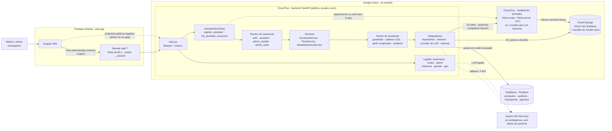

# Arquitetura Técnica do Sistema

> **Localização Mandatória:** `.agents/docs/architecture/ARCHITECTURE.md`  
> **Responsável:** Arquiteto (`architect.md`)  
> **Última Atualização:** 2026-11-16 — F0 da Fase 3 (Rodada 1). Descreve o que existe hoje (Fases 1 e 2) e a arquitetura-alvo do assistente médico (Fase 3).  
> **Status:** Proposto, aguarda o checkpoint da F0. As seções marcadas com **[alvo]** ainda não existem no código.

---

## 1. Visão Geral da Arquitetura

O HealthAI é um **monólito modular** (um backend FastAPI e um frontend Angular) para apoio à decisão em saúde da mulher. Três capacidades convivem no mesmo backend:

| Fase | Capacidade | Situação |
| :--- | :--- | :--- |
| 1 | Triagem diagnóstica (modelos tabulares, visão e texto com RAG) e laudo explicativo por LLM | Em produção |
| 2 | Otimização de hiperparâmetros por algoritmo genético e roteirização logística (VRP) com chat | Em produção |
| 3 | **Assistente médico**: LLM fine-tuned, prontuário estruturado, RAG com fontes, fluxos LangGraph com validação humana, auditoria | **[alvo]** F0–F11 |

### Objetivos não funcionais

| Atributo | Meta | Onde está decidido |
| :--- | :--- | :--- |
| Custo | Projeto inteiro no free tier ou até R$5/mês | D14, ADR-010 |
| Disponibilidade | Escala a zero em tudo; cold start aceito e sinalizado na tela | ADR-002 |
| Latência | Toda rota autenticada abaixo de 60 s; geração do LLM com p95 ≤ 45 s | ADR-012 |
| Durabilidade | Prontuário, auditoria, fluxos e vetores sobrevivem a cold starts | ADR-011 |
| Privacidade | Minimização no contrato; dados de paciente nunca vão ao Gemini gratuito | ADR-002, ADR-003, RIPD |
| Segurança clínica | Nenhuma conduta aprovada sem médico identificado | ADR-004 |
| Escala esperada | Uso acadêmico: poucos usuários simultâneos, cerca de 5 h de uso por mês | `plans/00-custos-finops.md` |

### Princípio de convivência
A Fase 3 **não refatora o legado**. O assistente entra por um único ponto de ligação (seção 5), fica atrás de uma feature flag e, desligado, não altera o comportamento das Fases 1 e 2.

---

## 2. Stack Tecnológica Oficial

| Camada | Tecnologia |
| :--- | :--- |
| Linguagem (backend) | Python 3.12 (`python:3.12-slim`) |
| Framework de backend | FastAPI + uvicorn (ASGI), Pydantic; `pydantic-settings` **[alvo]** |
| Frontend | Angular 21 (componentes standalone), hospedado no Firebase Hosting |
| ML clássico (Fases 1 e 2) | scikit-learn, PyTorch (CPU-only **[alvo]**), ensemble tabular, visão, texto |
| LLM legado | Gemini e OpenAI por `clinical_llm.py` e `logistics_llm.py`, com cadeia de fallback própria |
| LLM do assistente **[alvo]** | Modelos de 1 a 2,5B com QLoRA, exportados em GGUF Q4_K_M, servidos por `llama-swap` + `llama-server` em CPU |
| Orquestração de LLM **[alvo]** | LangChain (LCEL, tools), LangGraph (`StateGraph`, `PostgresSaver`, `interrupt`) |
| RAG | Hoje: LangChain + Chroma em disco. **[alvo]**: pgvector, busca híbrida, embeddings de 384 dimensões |
| Banco de dados | Hoje: só SQLite do cache de rotas. **[alvo]**: Postgres do Supabase, SQLAlchemy 2.0, Alembic, `psycopg` 3 |
| Nuvem | Google Cloud (Cloud Run, Cloud Storage, Artifact Registry, Cloud Build, Logging), Firebase Hosting, Supabase |
| Treino (offline) **[alvo]** | Computador pessoal com GPU, `transformers` + `peft` + `trl` + Optuna; fora da imagem de produção |
| Qualidade e CI/CD | pytest, GitHub Actions (`deploy.yml`; job de testes bloqueando deploy **[alvo]**) |

---

## 3. Camadas Existentes (Fases 1 e 2)

### 3.1 Backend (`backend/app/`)

| Camada | Pasta | Responsabilidade | Observações |
| :--- | :--- | :--- | :--- |
| Entrada | `main.py` | Cria o app, `lifespan` (carrega os modelos na memória), rate limiter por IP, CORS, registra 3 routers, health check em `/` | O entrypoint é `backend/app/main.py` (`uvicorn app.main:app`) |
| API | `api/routers/` | `anamnesis.py` (`/api/v1/anamnesis`), `routes_router.py` (`/api/v1/routes`), `admin.py` (`/admin`) | Sem envelope `data`/`meta` (L11). `routes_router.py` concentra lógica além de roteamento |
| Contratos | `models/schemas.py` | DTOs Pydantic de entrada e saída | — |
| Serviços | `services/` | `inference.py` (orquestra os modelos e lê o modelo ativo), `clinical_llm.py`, `logistics_llm.py`, `llm_governance.py` (guard anti-injection e cache por similaridade), `geo/` (OSRM e cache SQLite) | `llm_governance.py` é reaproveitado pelo assistente |
| Inferência | `ml/` | `tabular.py`, `vision.py`, `text.py` (usa o RAG), `ensemble.py` | Modelos congelados em `weights/` |
| Otimização | `genetic/` | `hyperopt/` (AG de hiperparâmetros) e `routing/` (VRP) | — |
| Conhecimento | `backend/knowledge_base/` | Ingestão de PDFs e consulta ao Chroma (`get_rag_context`) | Migra para pgvector na F6, mantendo a assinatura |
| Laboratório | `backend/training_scripts/` | Treino offline dos modelos clássicos | Não deveria ir para a imagem (L12) |

Não há camada de repositório nem banco relacional de domínio. Logs são feitos com `print()` (L3).

### 3.2 Frontend (`frontend/src/app/`)

| Camada | Pasta | Conteúdo |
| :--- | :--- | :--- |
| Rotas | `app.routes.ts` | `/` (anamnese), `/routes` (logística), `/admin/login`, `/admin/dashboard` (protegida) |
| Páginas (containers) | `pages/` | `anamnesis`, `dashboard`, `medical-routes`, `admin-login`, `admin-dashboard` |
| Componentes visuais | `components/` | `button`, `card`, `input` |
| Serviços | `services/` | `anamnesis.service.ts`, `routes.service.ts`, `admin.service.ts`, `auth.service.ts` |
| Transversais | `guards/`, `interceptors/` | `auth.guard.ts` (síncrono), `auth.interceptor.ts` (Bearer) |

O token de admin fica em `localStorage` (L7) e as chamadas vão direto ao `run.app`.

### 3.3 Dívidas conhecidas do legado (fora do escopo da Fase 3, salvo indicação)

| # | Dívida | Tratamento |
| :--- | :--- | :--- |
| L3 | `print()` em vez de log estruturado | Código novo usa log estruturado (F5); o legado fica |
| L7 | JWT em `localStorage` | Resolvida na F9 (ADR-012, ADR-008) |
| L11 | Routers sem envelope | Só os routers novos nascem com envelope |
| L13 | `GET /admin/active-models` sem autenticação | Endpoints novos nascem protegidos |
| — | `admin.py` cai em segredo e senha padrão quando a variável não existe | Substituído por `core/security.py` na F9 |
| — | Rate limiter em memória, por instância | Mantido; o assistente ganha limite por usuário |

---

## 4. Onde o Assistente se Encaixa **[alvo]**

O assistente é um **módulo novo dentro do mesmo backend**, organizado por portas e adaptadores. O núcleo (`app/assistant/`) não importa FastAPI, SQLAlchemy nem clientes de nuvem diretamente: depende de ports, e as implementações são ligadas no bootstrap.

### 4.1 Regra de dependência

```
api/routers  →  services  →  assistant (cadeias, grafo, guardrails, ports, schemas)
                                  ▲
                                  │ implementam os ports
   repositories + db   ·   assistant/llm (cliente HTTP)   ·   assistant/retrieval (pgvector)   ·   assistant/audit/sinks
```

- **Routers** só recebem, chamam um service e devolvem o envelope.
- **Services** (`assistant_service`, `flow_service`, `model_selection_service`) orquestram casos de uso.
- **Núcleo do assistente** contém as regras: guardrails, citação, alertas, topologia do grafo.
- **Adaptadores** falam com Postgres, com o `healthai-llm`, com o Cloud Storage e com o Gemini.
- **O legado não importa o assistente**, e o assistente só reaproveita do legado utilitários sem estado (`llm_governance.py`).

### 4.2 Mapa de módulos e fase que cria cada um

| Módulo | Conteúdo | Fase |
| :--- | :--- | :-: |
| `app/core/` | `settings.py`, `pii_patterns.py` | F0 |
| | `logging_config.py`, `trace.py`, `exception_handlers.py` | F5 |
| | `security.py` (papéis, cookie) | F9 |
| `app/db/`, `app/repositories/` | Sessão, models, seed, repositórios, `records_adapter.py` | F4 |
| `app/assistant/errors.py`, `bootstrap.py` | Erros de domínio e ponto único de ligação | F0 (o bootstrap evolui até a F9) |
| `app/assistant/ports.py`, `schemas/` | Ports e schemas de domínio | F4–F8 |
| `app/assistant/audit/`, `guardrails/` | Auditoria com `trace_id`, mascaramento de PII, guards de entrada e saída | F5 |
| `app/assistant/retrieval/` | Embeddings, retriever, formatação do contexto com fonte | F6 |
| `app/assistant/llm/` | Registro, modelo ativo, provider, autenticação no Cloud Run, aquecimento; `prompts/`, `tools/`, `chains/` | F3, F7 |
| `app/assistant/graph/` | Estado, regras de alerta, nós, fluxo, checkpoint | F8 |
| `app/services/` | `assistant_service.py`, `flow_service.py`, `model_selection_service.py` | F7, F8, F9 |
| `app/api/` | `envelope.py`, `dependencies/rate_limit.py`, routers `auth`, `assistant`, `admin_audit`, `admin_models` | F9 |
| `backend/llm_service/` | Imagem do serviço `healthai-llm` | F3 |
| `backend/finetuning/`, `backend/evaluation/` | Laboratório offline, fora da imagem do backend | F1–F3, F10 |
| `backend/migrations/` | Alembic | F4, F6, F8 |
| `frontend/.../pages/medical-assistant/`, `components/assistant/` | Tela do assistente e seção de modelos no admin | F9 |

### 4.3 Caminho de uma pergunta (`POST /api/v1/assistant/ask`)

1. Router valida o DTO e o papel `MEDICO`; chama `AssistantService.ask`.
2. Gera `trace_id`; se o modelo não está `READY`, devolve 503 `AST-022` na hora.
3. `InputGuard` (injection, escopo, PII no texto).
4. Em paralelo: snapshot minimizado do prontuário (port) e trechos de protocolo (retriever).
5. Prompt com contexto rotulado → fine-tuned no `healthai-llm` (ou contingência, conforme a P-051).
6. `OutputGuard` (prescrição direta, citação obrigatória, vazamento de PII).
7. Auditoria de cada etapa; resposta no envelope, com `citations`, `patient_data_used` e `meta.model`.

### 4.4 Tratamento de erros
- Toda exceção de domínio do assistente herda de `AssistantDomainError(code, http_status, public_message)`.
- Um handler global (F5) traduz para `{error, code, trace_id}`, sem stack trace.
- Faixas de código reservadas:

| Faixa | Dono | Exemplos já definidos |
| :--- | :--- | :--- |
| `AST-001…019` | F5 (guardrails, auditoria) | — |
| `AST-020…049` | F7 e F8 (LLM, fluxos) | `AST-020` fluxo não encontrado · `AST-021` fine-tuned indisponível com dados de paciente · `AST-022` modelo carregando |
| `AST-050…069` | F9 (API, auth, seleção de modelo) | `AST-051` candidato inelegível · `AST-052` candidato indisponível |
| `AST-4xx` | F4 (prontuário) | `AST-404` paciente não encontrado |

---

## 5. Bootstrap: Ponto Único de Ligação **[alvo]**

### 5.1 Contrato
`app/assistant/bootstrap.py` expõe duas funções, e são as **únicas** referências ao assistente em `backend/app/main.py`:

| Função | Quando roda | Responsabilidade |
| :--- | :--- | :--- |
| `register_assistant(app)` | Na importação do módulo, depois dos `include_router` existentes | Registra routers, handlers de exceção e middlewares do assistente, conforme as flags |
| `init_assistant_resources()` | Primeira instrução do `lifespan`, antes de `inference_service.load_all_models()` | Inicializa recursos (conexão com o banco, serviços, aquecimento do LLM). Nunca derruba o backend |

A edição no `main.py` é feita uma vez, na F0. Dali em diante, cada fase liga o que produz **dentro do bootstrap**, sem tocar no `main.py`.

### 5.2 Evolução por fase

| Fase | `register_assistant(app)` | `init_assistant_resources()` |
| :-: | :--- | :--- |
| F0 | Router stub: `/api/v1/assistant/*` → 501 com a flag desligada | Não faz nada |
| F4 | — | `init_records_db()`: só confere a conexão |
| F5 | `register_security(app)`: middleware de `trace_id`, handlers globais de exceção e `configure_logging` | — |
| F6 | — | `init_retriever()`: carrega o modelo de embeddings uma única vez |
| F7 | — | `init_assistant_service()`; dispara o aquecimento do modelo ativo, sem bloquear |
| F8 | — | Checkpointer e `FlowService` |
| F9 | Routers `auth`, `assistant`, `admin_audit`, `admin_models`; o stub 501 sai. Com a flag desligada, só o `auth` fica ativo | — |

### 5.3 Regras do bootstrap
1. **Falha isolada:** erro ao inicializar um recurso do assistente é registrado em log e marca o assistente como indisponível (as rotas respondem 503). O backend sobe e as Fases 1 e 2 funcionam.
2. **Sem trabalho pesado no startup:** nada de migração, seed, DDL ou carga de modelo de LLM dentro do processo do backend.
3. **Sem bloqueio:** o aquecimento do LLM é disparado e não esperado (P-052).
4. **Composição explícita:** o bootstrap é o único lugar que conhece as implementações concretas dos ports. Testes trocam as implementações pela fixture `settings_override` e por ports falsos.
5. **Idempotência:** chamar as duas funções mais de uma vez (testes, recarga) não duplica routers nem recursos.

---

## 6. `AssistantSettings` e Feature Flags **[alvo]**

`app/core/settings.py`: `AssistantSettings(BaseSettings)`, lida por `get_settings()` com cache. É a única fonte de configuração do assistente; nenhum módulo lê `os.environ` direto.

| Setting | Finalidade | Produção | Desenvolvimento |
| :--- | :--- | :--- | :--- |
| `assistant_enabled` | Flag principal do assistente | `true` a partir da F11 | `false` por padrão |
| `assistant_default_candidate` | Fine-tuned usado antes de existir escolha no painel | id de um finalista | idem |
| `active_model_store_uri` | Onde fica a escolha do modelo ativo | objeto no Cloud Storage | arquivo local |
| `llm_service_url` | Endereço do servidor de LLM | URL do `healthai-llm` | `llama-swap` local |
| `llm_auth_mode` | `none` ou `cloud_run_id_token` | `cloud_run_id_token` | `none` |
| `gemini_fallback_model` | Modelo da contingência | definido | definido |
| `database_url` | Conexão da aplicação | pooler do Supabase, modo transação | Postgres local em Docker |
| `database_direct_url` | Conexão para migrações e seed | conexão com sessão completa | Postgres local |
| `embedding_model` | Modelo de embeddings escolhido na ablação | embutido na imagem | idem |
| `corpus_version` | Versão ativa do corpus do RAG | definido | definido |
| `rag_min_score` | Corte mínimo de relevância | definido | definido |
| `exam_sla_days` | Prazo para alerta de exame pendente | definido | definido |
| `doctor_username`, `doctor_password` | Usuário médico de demonstração | segredo | `.env` local |

### Feature flags

| Flag | Efeito | Origem |
| :--- | :--- | :--- |
| `ASSISTANT_ENABLED` | Desligada: rotas do assistente respondem 501 (F0) e, a partir da F9, só o `auth` fica ativo. Nenhum recurso do assistente é inicializado | F0 |
| `ALLOW_BEARER_TRANSITION` | Aceita Bearer além do cookie, durante a migração do auth | F9 |
| Modo agente (tool calling) | Liga o modo agente na cadeia de perguntas; o padrão é o modo determinístico | F7 (nome ainda não definido) |

Regras: sem valor padrão inseguro para segredos (sem segredo configurado, o recurso não sobe); `.env.example` documenta todas as variáveis; segredos só nos cofres do GitHub Actions e do Cloud Run.

---

## 7. Serviços Externos e Implantação

| Serviço | Papel | Configuração relevante | ADR |
| :--- | :--- | :--- | :--- |
| **Cloud Run — backend** (`healthai-diagnostics`, us-central1) | API FastAPI: Fases 1 e 2 e o assistente | Público, 2 GiB, `min-instances 0`, `max-instances 2`, cobrança por requisição | — |
| **Cloud Run — `healthai-llm`** | Inferência do fine-tuned (`llama-swap` + `llama-server`, CPU) | Privado (IAM + ID token), 4 vCPU / 4 GiB, `max-instances 1`, escala a zero, só o modelo ativo em memória | ADR-002 |
| **Cloud Storage** (`healthai-llm-models`) | GGUF dos finalistas (volume somente leitura do `healthai-llm`) e o objeto com a escolha do modelo ativo | us-central1, privado, lifecycle | ADR-002 |
| **Supabase (Postgres)** | Prontuário, auditoria, sugestões, alertas, checkpoints e vetores | Free tier, pooler em modo transação, RLS, keep-alive | ADR-011 |
| **Firebase Hosting** | Frontend Angular e rewrite `/api/**` para o backend (mesma origem) | Limite de 60 s, cookie `__session`, `no-store` | ADR-012 |
| **Gemini API (free tier)** | No assistente: só contingência, sem dados de paciente. No legado: laudos e chat das Fases 1 e 2 | Nunca recebe contexto de paciente do assistente | ADR-002 |
| **OpenAI API** | Só no legado (fallback das Fases 1 e 2) | Fora do assistente | — |
| **OSRM** | Rotas da Fase 2 | Legado | — |
| **Artifact Registry / Cloud Build** | Imagens do backend e do `healthai-llm` | Só as 2 versões mais recentes | ADR-010 |
| **Hugging Face Hub** | Adapters, model cards e cópia dos GGUF | Offline; não participa da execução | ADR-001 |
| **GitHub Actions** | CI, deploy, keep-alive do Supabase | Deploy só com testes verdes | — |

### Diagrama



---

## 8. Padrões de Projeto e Governança

### 8.1 Padrões adotados no código novo
- **Monólito modular** com **portas e adaptadores** no módulo do assistente; o legado mantém a organização atual em camadas (router → service → ml).
- **Repository Pattern** para todo acesso a banco; listagens sempre paginadas; índice em toda chave estrangeira.
- **Controllers finos:** recebem, chamam o service, devolvem o envelope.
- **Injeção por composição** no bootstrap (sem contêiner de injeção de dependência).
- **Regras clínicas determinísticas fora do LLM** (alertas, interações, guardrails); o LLM só redige.
- **Separação entre laboratório e produção:** `finetuning/`, `evaluation/`, `training_scripts/` e dados brutos ficam fora da imagem do backend.

### 8.2 Contratos de API
- Documentados em `.agents/docs/api_contracts/<entidade>.md` (o contrato do assistente sai na F9).
- Rotas novas: envelope `{data, meta}`, `snake_case`, status HTTP semânticos, erros `{error, code, trace_id}`, paginação com `limit` e `offset` e total em `meta`.
- Toda entrada validada por DTO Pydantic.

### 8.3 Documentação e comentários (padrão obrigatório para o Desenvolvedor)
- **Swagger/OpenAPI:** toda rota nova com `summary`, `response_model`, `responses` com os códigos de erro e `tags`; esquema de segurança do cookie declarado.
- **Docstrings:** todo módulo novo com docstring de topo dizendo o objetivo; toda função pública com docstring dizendo o que faz e por quê; regras de negócio citam o código `P-XXX`.
- **Sem `print()`** em código novo: log estruturado com `trace_id`, sem objetos inteiros e sem PII.
- **Frontend:** sem `any`; componentes visuais sem chamada de API; interfaces do contrato em `models/`.

### 8.4 ADRs da Fase 3

| ADR | Assunto | Dono |
| :--- | :--- | :--- |
| ADR-001 | Pool de triagem, finalistas, QLoRA, ambiente e HPO | `ai-specialist` |
| ADR-002 | Fine-tuned em produção no `healthai-llm` e contingência | `architect` |
| ADR-003 | Prontuário e acesso do LLM aos dados | `architect` |
| ADR-004 | LangGraph e validação humana | `architect` |
| ADR-005 | Dataset e anonimização | `ai-specialist` |
| ADR-006 | Avaliação | `ai-specialist` |
| ADR-007 | Guardrails (F5) | `security` |
| ADR-008 | Auth por cookie HttpOnly (F9) | `security` |
| ADR-009 | Seleção do modelo por scorecard | `ai-specialist` |
| ADR-010 | Orçamento no free tier | `devops` |
| ADR-011 | Persistência no Supabase | `architect` |
| ADR-012 | API na mesma origem e orçamento de 60 s | `architect` |
| ADR-013 | Vetorização do RAG (F6) | `ai-specialist` |

Os ADRs 007, 008 e 013 são escritos nas fases indicadas, não na F0.
