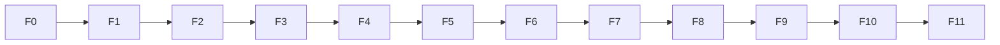

# Fase 3 — Modelo de Execução

> [Índice do plano](INDEX.md) · [Contexto e decisões](00-contexto-e-decisoes.md)

## Regra geral

- **Fases estritamente sequenciais.** A F(n+1) só começa quando a F(n) cumpriu o seu DoD, passou no Quality Gate e foi integrada em `feature/fase3` com CI verde.
- **Paralelismo só dentro da fase**, organizado em **rodadas**. Numa rodada, o Orquestrador despacha várias chamadas `Agent` **na mesma mensagem**. Cada agente (ou instância, ex.: `developer#1`, `developer#2`) recebe um **conjunto disjunto de arquivos** e um estado isolado `.agents/docs/STATE_F<n>_<agente>.md`, mesclado no `STATE.md` ao fim da rodada.
- A rodada seguinte só começa quando todos os agentes da rodada atual devolveram o resultado.

## Rodadas-padrão de uma fase (ajustadas fase a fase)

| Rodada | Etapa da pipeline | Quem (paralelo) | Saída |
| :--- | :--- | :--- | :--- |
| **R1 — Especificação** | Etapa 2 (às vezes 1) | Só os especialistas que a fase exige | Especificações, ADR-adendos, contratos da fase |
| **Checkpoint** (só onde indicado) | Fim da Etapa 2 | Orquestrador → usuário | Aprovação |
| **R2 — Testes (TDD)** | Etapa 3 | `tester` (1 ou mais instâncias, divididas por módulo) | Testes falhando que cobrem os critérios |
| **R3 — Implementação** | Etapa 3 | `developer#1…n` (+ `ai-specialist` quando há LLM/ML), por módulo | Código que faz os testes passarem |
| **R4 — Quality Gate** | Etapa 4 | `reviewer` ∥ auditores da fase (`privacy-officer`, `security`, `ux-reviewer`) ∥ `tester` (execução + Auto-Healer com o `developer`, até 3 tentativas) | Pareceres + suíte verde |
| **R5 — Fechamento** | Etapa 5 (quando há publicação) | Dono da fase (seção do relatório) ∥ `devops` (quando aplicável) ∥ Orquestrador (merge + `STATE.md`) | Merge em `feature/fase3` + seção `docs/fase3/secoes/*` |

## Matriz Agentes × Fases (quem participa de cada fase)

| Agente | F0 | F1 | F2 | F3 | F4 | F5 | F6 | F7 | F8 | F9 | F10 | F11 |
| :--- | :-: | :-: | :-: | :-: | :-: | :-: | :-: | :-: | :-: | :-: | :-: | :-: |
| `product-owner` | — | — | — | — | — | — | — | — | — | — | — | — |
| `analyst` | ● | — | — | — | — | — | — | — | — | — | — | — |
| `architect` | ● | — | — | — | ● | ● | — | — | ● | ● | — | — |
| `ai-specialist` | ● | ● | ● | ● | — | — | ● | ● | ● | — | ● | — |
| `dba` | — | — | — | — | ● | — | ● | — | — | — | — | — |
| `privacy-officer` | ● | — | ● | — | ● | ● | — | ● | — | ● | — | — |
| `security` | — | — | — | ● | ● | ● | ● | ● | — | ● | — | — |
| `designer` | — | — | — | — | — | — | — | — | — | ● | — | — |
| `tester` | ● | ● | ● | ● | ● | ● | ● | ● | ● | ● | ● | — |
| `developer` | ● | ● | ● | ● | ● | ● | ● | ● | ● | ● | ● | ● |
| `ux-reviewer` | — | — | — | — | — | — | — | — | — | ● | — | — |
| `reviewer` | ● | ● | ● | ● | ● | ● | ● | ● | ● | ● | ● | ● |
| `devops` | ● | — | — | ● | — | — | — | — | — | — | — | ● |
| `ai-governance-auditor` | — | — | — | — | — | — | — | — | — | — | ● | — |

> O `product-owner` não é acionado em nenhuma fase: o épico e as US-13…US-22 já estão no `ROADMAP.md`, e não há descoberta de produto nova.

## Matriz Etapas da Pipeline × Fases

| Etapa | F0 | F1 | F2 | F3 | F4 | F5 | F6 | F7 | F8 | F9 | F10 | F11 |
| :--- | :-: | :-: | :-: | :-: | :-: | :-: | :-: | :-: | :-: | :-: | :-: | :-: |
| 1 — Descoberta / Especificação | ● | — | — | — | — | — | — | — | — | — | — | — |
| 2 — Arquitetura / Design / Privacy | ● | ● | ● | ● | ● | ● | ● | ● | ● | ● | ● | — |
| Checkpoint com o usuário | ● | — | ● | — | ● | — | — | — | ● | ● | ● | — |
| 3 — TDD e Execução | ● | ● | ● | ● | ● | ● | ● | ● | ● | ● | ● | — |
| 4 — Quality Gate | ● | ● | ● | ● | ● | ● | ● | ● | ● | ● | ● | ● |
| 5 — Release / CI / MLOps | ● (CI) | — | — | ● (MLOps) | — | — | — | — | — | — | — | ● |

> **Checkpoints escolhidos:** F0 (ADRs globais, candidatos D1, scorecard pré-registrado, D3/D4), F2 (política de anonimização), F4 (schema do banco), F8 (desenho do grafo e da aprovação humana) e F9 (contrato da API + Design Plan) e F10 (escolha do modelo ativo no painel admin, a partir dos scorecards). Nas outras fases a especificação segue decisões já aprovadas, então a fase roda direto. Se o usuário pedir execução sem pausas, todos os checkpoints viram só um resumo no `STATE.md`.

## Estratégia Git
- Branch de integração **`feature/fase3`** (a partir da `master`). **Nunca integrar direto na `master`**: o `deploy.yml` publica em produção a cada push nela.
- Uma branch por fase: `feature/fase3-f<n>-<nome>`, criada a partir da `feature/fase3` atualizada e mesclada por PR no fechamento da fase. Os agentes paralelos de uma rodada trabalham na mesma branch da fase, cada um nos seus arquivos.
- Commits atômicos em Conventional Commits (um por passo de código), com o `P-XXX` no corpo quando houver regra envolvida.
- O assistente fica atrás da flag `ASSISTANT_ENABLED=false` até a F9. O PR final `feature/fase3` → `master` acontece na F11.

## DoD comum a todas as fases

- Testes escritos antes do código (TDD) e `pytest` verde no CI.
- Nenhum `print()` novo: usar `logging`.
- Docstring no topo de todo módulo explicando objetivo e porquê.
- Funções com até ~30 linhas e early return; no máximo 3 parâmetros (acima disso, DTO).
- Constantes nomeadas no lugar de números mágicos.
- Nenhuma documentação na raiz do repositório.
- Checklist do arquivo da fase marcado e status atualizado no cabeçalho.
- PR da fase mesclado em `feature/fase3`.

## Riscos e Mitigações

| Risco | Impacto | Mitigação |
| :--- | :--- | :--- |
| Execução sequencial alonga o prazo total | Atraso | Paralelismo máximo dentro de cada fase (várias instâncias de `tester`/`developer` por módulo); fases enxutas com só os agentes necessários; checkpoints só em 6 fases |
| GPU local limitada (GTX 1660 SUPER, 6 GB, sem bf16) | Treino lento, falta de memória ou NaN em fp16 | Candidatos 1B/1,5B, QLoRA 4-bit, batch 1–2 com gradient checkpointing, `max_seq_length` ≤ 1024, Unsloth no WSL2, `compute_dtype` fp32 se o fp16 instabilizar; ambiente testado já na F0 (0.9); Kaggle gratuito como contingência; pedir acesso ao LLaMA já na F0 |
| Busca de hiperparâmetros estourar o orçamento de GPU | Atrasa a F3 | `HPO_N_TRIALS` + `HPO_TIMEOUT_HOURS` calibrados por medição real; poda Hyperband; estudo retomável (SQLite local); no pior caso, o warm start já garante uma config padrão boa |
| Latência do fine-tuned em CPU alta demais | Demo lenta | Candidatos 1B/1,5B em Q4, `ctx-size` enxuto, poucos chunks de RAG, prompt de sistema fixo no início (cache de prompt do `llama-server`) e `max_tokens` limitado; a latência pesa no scorecard; streaming na UI como melhoria |
| Ultrapassar R$5/mês | Viola a D14 | Alerta de orçamento, limpeza do Artifact Registry, PyTorch CPU-only, `max-instances`, rate limit e autenticação; revisão de custo em F3, F10 e F11 ([custos e FinOps](00-custos-finops.md)) |
| Backend sem memória (2 GiB) com PyTorch, modelos de visão, embeddings, LangChain e LangGraph | Erro de memória e cold start longo | Medir memória e tempo de inicialização na F6 e na F7; subir para 3–4 GiB se passar de 80% (ainda dentro do free tier: 4 GiB × 5 h ≈ 72 mil GiB-s); carregar os modelos legados sob demanda como melhoria opcional |
| `llama-swap` (componente de terceiros) falhar ou mudar | Troca de modelo quebra | Versão fixa e smoke de troca no CI da F3; na F0, verificar o roteamento nativo do `llama-server`; plano B: um serviço Cloud Run por finalista (desenho anterior, também com escala a zero) |
| Projeto Supabase pausar por inatividade | Banco fora do ar: o assistente responde 503 e o RAG volta vazio | Keep-alive semanal no GitHub Actions, com aviso se o job falhar; reativação manual no painel do Supabase como último recurso |
| Requisição autenticada passar de 60 s no Firebase Hosting | 504 para o usuário | Gate de latência p95 ≤ 45 s, `/ask` com 503 imediato enquanto o modelo carrega, fluxos em passos, `max_tokens` limitado |
| Uso real do Cloud Run bem acima da estimativa (~5 h/mês; o free tier comporta ~10 h) | Sai do free tier (≈ R$2 por hora extra de LLM) | `max-instances 1`, autenticação, rate limit, alerta de orçamento; bateria pesada da F10 no computador local |
| Cold start do `healthai-llm` (escala a zero) | Primeira resposta depois de ocioso leva dezenas de segundos | Aceito (D14) e mitigado: o backend dispara o carregamento do modelo ativo junto com o próprio cold start (P-052); aviso de "carregando o modelo" na UI; sem `min-instances`, por custo |
| Nenhum fine-tuned passar nos gates | Bloqueia a entrega (P-051) | A F10 devolve para a F3 com o diagnóstico do scorecard (mais dados, nova HPO, outro candidato) |
| Treinar vários candidatos na mesma GPU local | Alonga a F3 | Triagem barata dos 5 modelos e HPO só para os 2–3 finalistas, orçamento de HPO por finalista, treinos noturnos e estudo retomável; se o prazo apertar, o segundo candidato treina só com a config padrão (registrado no scorecard) ou roda no Kaggle gratuito em paralelo |
| Ajustar o scorecard depois de ver resultados (viés de escolha) | Escolha enviesada | YAML congelado com hash no ADR-009; `run_scorecard` falha se o hash divergir; mudança exige adendo e reavaliação de todos |
| Licença gated do LLaMA ou da Gemma demorar | Tira o modelo da triagem | Pedir na F0; a triagem segue com os outros modelos do pool (nenhum é obrigatório) |
| Conflito entre agentes paralelos na mesma rodada | Retrabalho | Arquivos exclusivos por agente em cada rodada (tabelas das fases); estado isolado `STATE_F<n>_<agente>.md` |
| Integração publicando em produção | Quebra o Cloud Run | `feature/fase3` + job `test` no CI + flag `ASSISTANT_ENABLED` |
| Modelo FT alucina ou esquece o inglês | Qualidade | Mistura bilíngue, `r` baixo, RAG + CitationGuard, avaliação base vs FT |
| PII no dataset, nos logs ou na UI | LGPD / veto | `pii_patterns` único, gate P-047, masker, auditorias com veto nas fases F2, F4, F5, F7 e F9 |
| Escopo grande para o prazo | Entrega parcial | Opcionais cortáveis sem ferir requisito obrigatório: modo agente da F7, retriever híbrido da F6, tela completa da F9 (fica o Swagger) |
