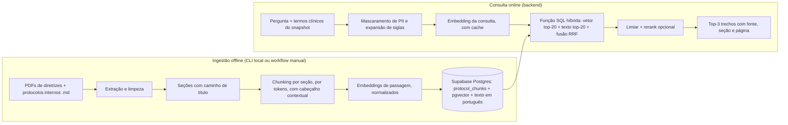

# Fase 3 — Estratégia de Vetorização e Recuperação (D17)

> [Índice do plano](INDEX.md) · [Contexto e decisões](00-contexto-e-decisoes.md) · [F6 — RAG](F06-rag-fontes.md) · [Custos e FinOps](00-custos-finops.md)

## Objetivo

Definir como os protocolos viram vetores e como o assistente encontra o trecho certo, com a fonte exata e em pouco tempo de CPU. Cada escolha (tamanho do trecho, modelo de embeddings, busca híbrida, rerank) é **decidida por medição** num gold set, com uma regra fixada antes de ver os resultados.

## Visão geral

## 1. Extração e limpeza

| Problema típico dos PDFs | Estratégia |
| :--- | :--- |
| Cabeçalhos e rodapés repetidos poluem os vetores | Remove linhas que aparecem em mais de 50% das páginas do documento |
| Palavras quebradas por hifenização no fim da linha | Junta "rastrea-\nmento" → "rastreamento" |
| Títulos de seção sem marcação | Detecta por numeração ("2.3 Rastreamento"), caixa alta e, quando ajuda, tamanho de fonte (`pdfplumber`, licença MIT) |
| Tabelas viram texto embaralhado | Mantém a tabela como um bloco único com a legenda; não divide no meio |
| Protocolos internos em markdown (F1) | Cabeçalhos `#`/`##` viram o caminho da seção |

Saída: `Section{doc_id, title, section_path, page_start, page_end, text, source_type, doc_version}`, com `source_type` em `guideline` (PDFs) ou `internal_protocol` (sintéticos).

## 2. Chunking

- **Por seção primeiro, por tamanho depois:** cada seção é dividida com `RecursiveCharacterTextSplitter` medindo **tokens do tokenizer do modelo de embeddings** (não caracteres), sem cortar frases.
- **Tamanho e sobreposição decididos na ablação:** candidatos de 250, 350 e 500 tokens, com sobreposição de 0% ou ~15%. Ponto de partida: 350 com 50 de sobreposição. Trechos menores dão citações mais precisas e prompts menores (latência em CPU); trechos maiores dão mais contexto.
- **Cabeçalho contextual:** o texto que vira vetor é `"Documento: <título> | Seção: <caminho> \n\n <trecho>"`. Isso ajuda o embedding a saber de onde o trecho vem ("rastreamento" de câncer de mama ≠ de SOP). O texto mostrado na citação é só o trecho.
- **Id estável:** `chunk_id = sha1(source_file | section_path | texto)[:16]`. Reingerir o mesmo documento gera os mesmos ids.

## 3. Modelo de embeddings

Todos os candidatos têm **384 dimensões**, então a coluna `vector(384)` serve para qualquer um, e trocar de modelo é só reingerir.

| Candidato | Tamanho | Português | Observação |
| :--- | :-: | :-: | :--- |
| `sentence-transformers/all-MiniLM-L6-v2` (atual) | ~90 MB | Fraco | Linha de base; centrado em inglês |
| `sentence-transformers/paraphrase-multilingual-MiniLM-L12-v2` | ~470 MB | Bom | Multilíngue genérico |
| `intfloat/multilingual-e5-small` | ~470 MB | Bom | Feito para recuperação; exige os prefixos `query:` e `passage:` |

- Vetores **normalizados** (cosseno = produto interno).
- **Fora:** modelos de 768–1024 dimensões, como `bge-m3`, que não cabem com folga no backend de 2 GiB.
- O modelo escolhido é **baixado na build da imagem** (`HF_HUB_OFFLINE=1` em produção). Documentos são vetorizados **só na ingestão offline**; o backend vetoriza apenas consultas, com cache LRU.
- Otimização opcional, se a memória apertar: exportar o modelo para ONNX com quantização int8.

## 4. Armazenamento: pgvector no Supabase

Tabela `protocol_chunks` no mesmo Postgres do prontuário (D15), criada por migração Alembic (F6):

| Coluna | Tipo | Uso |
| :--- | :--- | :--- |
| `chunk_id` | `text` (PK com `corpus_version`) | Id estável |
| `source_file`, `title`, `section_path`, `page_start`, `page_end`, `doc_version`, `source_type` | texto/inteiros | Citação e filtros |
| `content` | `text` | Trecho exibido |
| `content_tsv` | `tsvector` gerado (`to_tsvector('portuguese', unaccent(content))`) | Busca por texto |
| `embedding` | `vector(384)` | Busca vetorial |
| `embedding_model`, `corpus_version`, `ingested_at` | texto/data | Versionamento |

- **Índices:** GIN em `content_tsv`; B-tree em `(corpus_version, source_type)`. Para o corpus atual (poucos milhares de trechos), a busca vetorial **exata** é rápida e tem recall de 100%, então não há índice aproximado. Um índice HNSW (`vector_cosine_ops`, `m=16`, `ef_construction=64`) entra só se o corpus passar de ~10 mil trechos.
- **Volume:** ~2 mil trechos × (1,5 KB de vetor + ~2 KB de texto) ≈ 7 MB, longe dos 500 MB do free tier.
- **Acesso:** o backend usa um papel Postgres só com leitura na tabela (RLS ligada); a ingestão usa outro papel, com escrita. Nenhuma chave `service_role` no backend.

## 5. Busca híbrida (vetor + texto) com fusão RRF

Termos clínicos exatos (BI-RADS 4, CID, nomes de fármacos) às vezes se perdem no vetor; a busca por texto em português pega esses casos. A função SQL `match_protocol_chunks(query_embedding, query_text, k, source_types, corpus_version)` faz numa ida ao banco:

1. top-20 por distância de cosseno (`embedding <=> query_embedding`);
2. top-20 por `ts_rank_cd` com `websearch_to_tsquery('portuguese', unaccent(query_text))`;
3. fusão **RRF**: `score = Σ 1 / (60 + posição)`;
4. devolve os k melhores com metadados e o score.

A busca só vetorial continua disponível por parâmetro, e a ablação decide qual vira padrão.

## 6. Estratégias do lado da consulta

- **Mascaramento:** a pergunta passa pelo `pii_masker` (F5) antes de virar vetor.
- **Expansão de siglas** pelo glossário (`GLOSSARY.md`): "SOP" → "síndrome dos ovários policísticos (SOP, PCOS)", "BI-RADS" etc.
- **Consulta enriquecida com o paciente:** quando há `patient_code`, entram termos clínicos do snapshot (diagnósticos, exames pendentes, resultado BI-RADS), **nunca identificadores**.
- **Filtros por metadado:** a Fase 1 usa só `guideline`; o assistente usa os dois tipos.

## 7. Rerank opcional

Um cross-encoder multilíngue pequeno (ex.: `cross-encoder/mmarco-mMiniLMv2-L12-H384-v1`) reordena os 20 melhores. Custa ~100–300 ms de CPU por pergunta e mais memória. **Só entra** se a ablação mostrar ganho de pelo menos 5 pontos de recall@3 no conjunto de desenvolvimento, dentro do orçamento de latência.

## 8. Versionamento e troca sem indisponibilidade

A ingestão grava uma `corpus_version` nova, roda um smoke de recuperação com o gold set, **só então** passa a configuração ativa para a nova versão e apaga a anterior. Uma ingestão com erro nunca deixa o assistente sem base.

## 9. Avaliação e regra de escolha (pré-registrada)

- **Gold set:** 80–100 perguntas em pt-BR, cada uma com os trechos, a seção e a página esperados, divididas em **desenvolvimento (70%)** e **teste (30%)**. Toda escolha usa o desenvolvimento; o teste só confirma o resultado e alimenta a F10.
- **Métricas:** recall@3 (principal), MRR, nDCG@5, latência da recuperação e memória do modelo de consulta.
- **Grade da ablação:** tamanho do trecho × sobreposição × modelo × híbrida (sim/não) × rerank (sim/não). Roda em minutos no computador local, porque o corpus é pequeno.
- **Regra:** maior recall@3, com MRR como desempate; restrições de recuperação ≤ 300 ms e modelo de consulta ≤ 500 MB de memória. A regra fica no `knowledge_base/config/vectorization.yaml` e no ADR-013 **antes** da primeira rodada.
- **Saída:** `evaluation/results/rag_ablation.{json,md,png}` para o relatório (E6/E8).

## 10. Falhas e compatibilidade

- **Banco indisponível** (ex.: Supabase pausado): a recuperação devolve lista vazia e registra `RETRIEVAL_FAILED`. O assistente responde "Não há informações suficientes" (P-041), e a triagem da Fase 1 segue sem contexto, como já faz quando o RAG volta vazio.
- **Fase 1:** `get_rag_context()` mantém a assinatura e a saída em string, usando só `guideline`, só vetor, k=3 e sem limiar, para a triagem antiga receber trechos equivalentes aos de hoje.
- **Fim do Chroma:** depois da migração, `chromadb`, `langchain-chroma` e o binário `knowledge_base/vector_db/` saem do repositório e da imagem, que fica menor (menos custo no Artifact Registry).