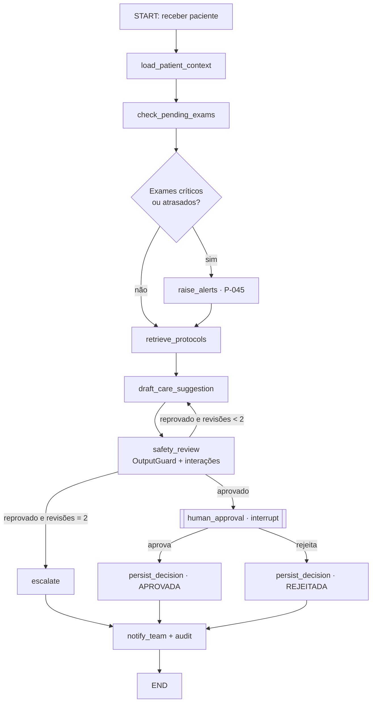

# F8 — Fluxos Automatizados com LangGraph e Aprovação Humana (R2.3, R3.1, R3.2, E3)

> [Índice](INDEX.md) · Anterior: [← F7](F07-assistente-langchain.md) · Próxima: [F9 →](F09-api-auth-interface.md)  
> Referências: [Contexto e decisões](00-contexto-e-decisoes.md) · [Modelo de execução](00-modelo-de-execucao.md)  
> **Status:** ⏳ Não iniciada

## Objetivo

Implementar o fluxo pedido no PDF (receber paciente → verificar exames pendentes → emitir alertas → sugerir conduta), com pausa obrigatória para validação médica e retomada persistente; execução em passos, com no máximo uma chamada ao LLM por requisição, para caber no limite de 60 s do Firebase Hosting (D16).

## Ponto de partida
- **Projeto:** nada de LangGraph (as dependências entraram na F0). Os checkpoints ficam no Postgres do Supabase (D15): um fluxo pausado sobrevive a cold starts e pode ser retomado por qualquer instância.
- **Fases anteriores:** `PatientRecordsPort` (alertas, sugestões) + `SEED_SCENARIOS` (F4); `OutputGuard` + `AuditLogger` (F5); `ProtocolRetriever` (F6); `CareSuggestionDrafter` (F7).

## Etapas e agentes
- **Etapas ativas:** 2 (desenho do grafo e da aprovação), **Checkpoint**, 3, 4.
- **Acionados:**

| Agente | Papel nesta fase |
| :--- | :--- |
| `architect` | Dono: estado, nós, arestas condicionais, semântica de interrupt/resume, garantia "sem aprovação sem humano" |
| `ai-specialist` | Regras de alerta P-045, tabela de interações (com ressalva clínica), uso do drafter nos nós |
| `tester` (×2) | Regras puras / grafo, cenários e propriedade |
| `developer` (×2) | Nós + grafo / checkpointer + service + diagrama |
| `reviewer` | Quality Gate (inclui a checagem da propriedade de HITL) |

- **Não acionados:** `security` (sem superfície externa nova: a autorização de quem aprova é aplicada na F9, e o bypass de HITL é coberto pelo teste de propriedade sobre o grafo), `privacy-officer` (o estado usa só o snapshot já minimizado da F4 e não guarda PII direta; a retenção dos checkpoints já está no RIPD da F0), `dba` (checkpointer gerenciado pelo LangGraph), `designer`/`ux-reviewer`, `devops`.

## Execução em rodadas

| Rodada | Agente (paralelo) | Tarefas | Arquivos exclusivos |
| :--- | :--- | :--- | :--- |
| **R1** (Etapa 2) | `architect` | 8.1 + diagrama-alvo + regras de roteamento + contrato do `FlowService` | `app/assistant/graph/state.py`, `app/assistant/schemas/flow.py`, adendo no ADR-004 |
| | `ai-specialist` | Especificação de `alert_rules`/`interaction_rules` (SLA, BI-RADS, pares de interação rotulados como demonstrativos) | `.agents/docs/business_rules/BR-030-assistente-medico.md` (anexo P-045) |
| **Checkpoint** | Orquestrador | Diagrama do grafo + regras de alerta | — |
| **R2** (TDD) | `tester#1` | Regras puras (SLA, BI-RADS, interações) | `tests/assistant/graph/test_alert_rules.py`, `test_interaction_rules.py` |
| | `tester#2` | Cenários com `SEED_SCENARIOS` (pausa, approve, reject, escalonamento), resume depois de reconstruir o grafo, propriedade "todo caminho até `persist_decision` passa por `human_approval`", `thread_id` inexistente | `tests/assistant/graph/test_patient_intake_flow.py`, `tests/services/test_flow_service.py` |
| **R3** (código) | `ai-specialist` | 8.2 | `app/assistant/graph/{alert_rules,interaction_rules}.py` |
| | `developer#1` | 8.3, 8.4 | `app/assistant/graph/{nodes,patient_intake_flow}.py` |
| | `developer#2` | 8.5, 8.7 | `app/assistant/graph/{checkpointing,export_diagram}.py` |
| **R4** (integração) | `developer#2` | 8.6 + bootstrap; gerar o diagrama | `app/services/flow_service.py`, `bootstrap.py`, `docs/fase3/diagramas/patient_intake_flow.{mmd,png}` |
| **R5** (Etapa 4) | `reviewer` ∥ `tester` | Revisão ∥ suíte + Auto-Healer | — |
| **R6** (Fechamento) | `architect` ∥ Orquestrador | Seção E7 (fluxo e diagrama) ∥ merge + `STATE.md` | `docs/fase3/secoes/06-fluxos-langgraph.md` |

## Fluxo-alvo

## Código passo a passo
- [ ] **8.1 — `state.py`:** `IntakeState(TypedDict)` com `trace_id`, `patient_code`, `actor`, `snapshot`, `pending_exams`, `alerts: Annotated[list[AlertDraft], operator.add]`, `protocol_chunks`, `suggestion`, `guardrail_result`, `revision_count`, `approval`, `stage`; `FlowDependencies` (records, retriever, drafter, output_guard, audit, settings); schemas `FlowStatus`, `DecisionCommand`.
- [ ] **8.2 — Regras puras:** `overdue_exam_alerts(exams, today, sla_days)`, `critical_result_alerts(snapshot)` (BI-RADS ≥ 4 sem conduta); `INTERACTION_TABLE` (pequena e demonstrativa: tamoxifeno × fluoxetina/paroxetina, espironolactona × potássio…) e `find_interactions(medications, suggestion_text)`; `DEFAULT_SLA_DAYS`, `MAX_REVISIONS = 2`.
- [ ] **8.3 — `nodes.py`:** `make_nodes(deps) -> dict[str, Callable]` (injeção por closure; cada nó com ≤ 30 linhas e evento `FLOW_NODE` com duração): `load_patient_context`, `check_pending_exams`, `raise_alerts`, `retrieve_protocols`, `draft_care_suggestion`, `safety_review`, `escalate`, `human_approval` (**`interrupt({"suggestion", "alerts"})`**), `persist_decision` (`reviewed_by` obrigatório), `notify_team`.
- [ ] **8.4 — `patient_intake_flow.py`:** `build_patient_intake_graph(deps, checkpointer)` com `route_after_exam_check` e `route_after_safety`. **Não existe aresta para `persist_decision` sem passar por `human_approval`.**; compilado com `interrupt_before=["draft_care_suggestion"]`, para cada requisição executar no máximo uma chamada ao LLM (limite de 60 s do Firebase Hosting, D16).
- [ ] **8.5 — `checkpointing.py`:** `build_checkpointer(pool) -> PostgresSaver` (`langgraph-checkpoint-postgres`, conexão `psycopg` com `autocommit=True` e prepared statements desligados por causa do pooler); o `setup()` das tabelas de checkpoint roda na migração, não no startup.
- [ ] **8.6 — `services/flow_service.py`:** `start_intake(patient_code, actor) -> FlowStatus` (`thread_id = uuid4`; carrega contexto, exames, alertas e protocolos **sem LLM** e para antes do rascunho); `advance(thread_id) -> FlowStatus` (um rascunho + revisão de segurança, ou seja, **uma** chamada ao LLM, e para no próximo rascunho ou na aprovação humana); `get_status(thread_id)` (`graph.get_state`); `decide(cmd)` (`graph.invoke(Command(resume=…))`). `FlowStatus.next_action` ∈ {`advance`, `await_human`, `done`} diz ao frontend o que fazer. Com o modelo ainda carregando, `advance` devolve 503 `AST-022` na hora; `FlowNotFound` (AST-020).
- [ ] **8.7 — `export_diagram.py`:** `draw_mermaid()` → `.mmd` + `draw_mermaid_png()` → PNG em `docs/fase3/diagramas/` (E7).

## Critérios de aceite

Pausa em `human_approval` e retomada pelo `thread_id` depois de reconstruir o grafo; nenhuma aprovação sem humano; todo nó auditado; diagrama exportado; cada requisição faz no máximo uma chamada ao LLM; um fluxo iniciado numa instância é retomado por outra (checkpoint no Postgres).

## Audit

(1) seed "BI-RADS 4 sem conduta" → alerta `HIGH` + pausa; (2) `approve` → `APROVADA` com `reviewed_by`; (3) `reject` + comentário → `REJEITADA`; (4) seed de interação → 2 revisões → `escalate`; (5) teste de propriedade sobre `graph.get_graph().edges`; (6) `thread_id` inexistente → AST-020; (7) `advance` com o modelo carregando → 503 `AST-022` sem chamar o LLM; (8) fluxo pausado é retomado depois de recriar o backend.

## Commits

`feat(langgraph): define estado e regras de alerta (P-045)` · `feat(langgraph): cria nos do fluxo de admissao do paciente` · `feat(langgraph): adiciona interrupt e checkpointer para aprovacao medica (P-040)` · `feat(assistant): adiciona servico de fluxos` · `docs(diagram): exporta diagrama do fluxo langgraph`

## Entrega para a F9

`FlowService`; diagrama para o relatório.
