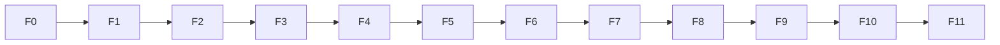

# Plano de Implementação — Fase 3: Assistente Médico Personalizado

> **Fonte dos requisitos:** `8IADT - Fase 3 - Tech challenge.pdf`
> **Classificação na triagem (AGENTS.md):** T1 — Nova Feature Completa (Full-Stack + IA + Dados Pessoais)
> **Versão:** v3 (2026-11-07) · **Status geral:** 📝 Planejado — aguardando a aprovação dos candidatos (D1) e do scorecard (D13) no checkpoint da F0, e a D4 (latência em CPU) confirmada na F3 · orçamento ≤ R$5/mês (D14)

O plano está dividido em **12 fases (F0–F11), executadas uma de cada vez**. Uma fase só começa quando a anterior cumpriu o DoD e foi mesclada em `feature/fase3`. **Dentro de cada fase**, o trabalho é organizado em **rodadas**: agentes em paralelo, cada um com arquivos exclusivos. Cada fase aciona só os agentes e as etapas da pipeline que agregam valor a ela.

## Como usar este plano

1. Leia [Contexto, Requisitos e Decisões](00-contexto-e-decisoes.md): requisitos do PDF, inventário do código existente, decisões D1–D17, matriz de rastreabilidade, estrutura de diretórios e regras P-040…P-052.
2. Leia o [Modelo de Execução](00-modelo-de-execucao.md): rodadas-padrão, matrizes Agentes × Fases e Etapas × Fases, estratégia Git, DoD comum e riscos.
3. Leia o [Scorecard de modelos](00-scorecard-modelos.md): candidatos, métricas pré-estabelecidas, gates e como o modelo do assistente é escolhido no painel admin.
4. Leia [Custos e FinOps](00-custos-finops.md): como o projeto inteiro cabe no free tier ou em até R$5/mês.
5. Leia a [Estratégia de vetorização](00-vetorizacao-rag.md): como os protocolos viram vetores e como o RAG é escolhido por medição.
6. Execute a fase atual pelo seu arquivo. Ao terminar, atualize o **Status** no cabeçalho do arquivo da fase, a tabela abaixo e o `.agents/docs/STATE.md`.

## Fases

| # | Fase | Objetivo | Requisitos do PDF | Agentes acionados | Checkpoint | Status |
| :--- | :--- | :--- | :--- | :--- | :-: | :-: |
| **F0** | [Fundação, Governança e Infraestrutura de Testes](F00-fundacao.md) | Deixar o repositório pronto para a Fase 3: regras, ADRs, RIPD, dependências, CI que bloqueia deploy quebrado, infraestrutura de testes, esqueleto de pastas e o ponto único de ligação do assistente no `main.py` | R4.1 | analyst, architect, ai-specialist, privacy-officer, devops, tester, developer, reviewer | ✓ | 🔄 |
| **F1** | [Coleta e Geração do Corpus](F01-corpus.md) | Montar o corpus bruto do fine-tuning: PubMedQA, MedQuAD filtrado e um corpus interno sintético em pt-BR (protocolos, FAQ de médicos, laudos, receitas e procedimentos) | R1.1–R1.3, E4 | ai-specialist, tester×2, developer×2, reviewer | — | ⏳ |
| **F2** | [Preprocessing, Anonimização e Curadoria](F02-anonimizacao-curadoria.md) | Transformar o corpus bruto em dataset de instruções limpo, anonimizado e curado, com split sem vazamento | R1.4, E1, E4 | privacy-officer, ai-specialist, tester×2, developer×2, reviewer | ✓ | ⏳ |
| **F3** | [Pipeline de Fine-tuning QLoRA, Otimização de Hiperparâmetros e Publicação](F03-fine-tuning-qlora.md) | Fazer a triagem de 5 modelos base e treinar os 2–3 finalistas com QLoRA usando a melhor configuração de hiperparâmetros encontrada por otimização bayesiana multifidelidade (Optuna TPE + Hyperband), registrar os experimentos e publicar os fine-tuned **em produção** (serviço único `healthai-llm` em CPU, com troca sob demanda e aquecimento automático, no free tier) | R1.1–R1.3, E1, E5 | ai-specialist, tester×2, developer×3, devops, security, reviewer | — | ⏳ |
| **F4** | [Base Estruturada de Prontuários e Registros](F04-prontuario.md) | Criar no Postgres do Supabase a base relacional sintética que o assistente consulta (pacientes, exames, diagnósticos, medicações, sugestões de conduta, alertas e auditoria), acessada só por repositórios e exposta ao assistente por um port com dados minimizados | R2.2, R2.3, E4 | dba, architect, privacy-officer, security, tester×2, developer×2, reviewer | ✓ | ⏳ |
| **F5** | [Segurança, Guardrails, Auditoria e Explainability](F05-seguranca-auditoria.md) | Construir, **antes** do assistente, os componentes transversais que toda resposta vai atravessar: guard de entrada, guard de saída (prescrição, citação, vazamento de PII), auditoria com `trace_id`, contrato de resposta explicável e handler global de erros | R3.1–R3.3 | security, architect, privacy-officer, tester×2, developer×2, reviewer | — | ⏳ |
| **F6** | [RAG de Protocolos: Vetorização, Busca Híbrida e Rastreabilidade de Fonte](F06-rag-fontes.md) | Migrar a base de conhecimento para pgvector no Supabase com chunking por seção, embeddings escolhidos por ablação e busca híbrida, com a fonte exata em cada trecho, sem quebrar a triagem da Fase 1 | R3.3, E2 | ai-specialist, dba, security, tester×2, developer×2, reviewer | — | ⏳ |
| **F7** | [Assistente Médico com LangChain](F07-assistente-langchain.md) | Montar o pipeline LangChain que integra a LLM fine-tuned (F3), o prontuário (F4), os guardrails e a auditoria (F5) e o RAG (F6), produzindo respostas contextualizadas, citadas e auditadas | R2.1–R2.3, R3.1–R3.3, E2 | ai-specialist, security, privacy-officer, tester×2, developer×2, reviewer | — | ⏳ |
| **F8** | [Fluxos Automatizados com LangGraph e Aprovação Humana](F08-fluxos-langgraph.md) | Implementar o fluxo pedido no PDF (receber paciente → verificar exames pendentes → emitir alertas → sugerir conduta), com pausa obrigatória para validação médica e retomada persistente | R2.3, R3.1, R3.2, E3 | architect, ai-specialist, tester×2, developer×2, reviewer | ✓ | ⏳ |
| **F9** | [API, Autenticação de Médicos e Interface do Assistente](F09-api-auth-interface.md) | Expor assistente, fluxos, alertas e auditoria via API REST com envelope; migrar a autenticação para cookie HttpOnly com papéis `ADMIN`/`MEDICO`; criar a tela do assistente com citações e painel de aprovação; seção de escolha do modelo do assistente no painel admin | R3.1–R3.3, E9 | architect, designer, security, privacy-officer, tester×2, developer×2, ux-reviewer, reviewer | ✓ | ⏳ |
| **F10** | [Avaliação do Modelo e Análise de Resultados](F10-avaliacao.md) | Medir o ganho do fine-tuning e a qualidade, a segurança e a explicabilidade do assistente, com resultados reproduzíveis; calcular o scorecard pré-registrado de todos os candidatos para a escolha no painel admin | E8 | ai-specialist, tester, developer×2, ai-governance-auditor, reviewer | ✓ | ⏳ |
| **F11** | [Documentação Final, Relatório, Deploy e Vídeo](F11-documentacao-release.md) | Consolidar o relatório técnico, completar os READMEs, publicar a versão com o assistente e preparar o roteiro do vídeo | R4.2, E5–E9 | devops, developer, orchestrator, reviewer | — | ⏳ |

Legenda de status: ⏳ não iniciada · 🔄 em andamento · ✅ concluída · ⛔ bloqueada

## Sequência

## Decisões pendentes

| ID | Decisão | Recomendação | Necessária antes de |
| :--- | :--- | :--- | :--- |
| D1 | Pool de modelos e regra de finalistas | Triagem de 5 modelos (`Llama-3.2-1B`, `Qwen2.5-1.5B`, `Qwen3-1.7B`, `Gemma-3-1B`, `Tucano-2b4`) → 2–3 finalistas com HPO; Gemini como referência (GPT fora por falta de crédito); escolha final no painel admin pelo scorecard (D13) | F0 (checkpoint) |
| D3 | Onde treinar | Computador pessoal (GTX 1660 SUPER 6 GB, WSL2); Kaggle gratuito só como contingência | Definida |
| D4 | Como servir o fine-tuned **em produção** (obrigatório) | Serviço único `healthai-llm` (`llama-swap` + `llama-server` em CPU): só o modelo ativo em memória, troca sob demanda, aquecimento automático no cold start, escala a zero, free tier; Gemini só como contingência, sem dados de paciente | F3 (latência confirmada na medição) |

> A **D12** (estratégia de otimização de hiperparâmetros) já está definida: otimização bayesiana multifidelidade com Optuna. Detalhes na [F3](F03-fine-tuning-qlora.md#estratégia-de-otimização-de-hiperparâmetros-d12).
> A **D13** (seleção do modelo ativo) também está definida: [scorecard de modelos](00-scorecard-modelos.md) pré-registrado na F0, calculado na F10 e usado pelo `ADMIN` para ativar o modelo no painel.
> A **D14** (orçamento) também está definida: projeto inteiro no free tier ou **até R$5/mês**. Ver [custos e FinOps](00-custos-finops.md).
> As **D15** (Supabase), **D16** (API na mesma origem via Firebase Hosting) e **D17** (vetorização, [estratégia](00-vetorizacao-rag.md)) também estão definidas.

Detalhes e demais decisões: [Contexto e decisões, seção 2](00-contexto-e-decisoes.md#2-decisões-de-arquitetura-propostas).

## Onde fica cada entregável do PDF

| Entregável | Fase(s) | Artefato principal |
| :--- | :--- | :--- |
| E1 Pipeline de fine-tuning | [F2](F02-anonimizacao-curadoria.md), [F3](F03-fine-tuning-qlora.md) | `backend/finetuning/` |
| E2 Integração LangChain | [F6](F06-rag-fontes.md), [F7](F07-assistente-langchain.md) | `backend/app/assistant/{retrieval,chains,tools,llm}/` |
| E3 Fluxos LangGraph | [F8](F08-fluxos-langgraph.md) | `backend/app/assistant/graph/` |
| E4 Dataset anonimizado/sintético | [F1](F01-corpus.md), [F2](F02-anonimizacao-curadoria.md), [F4](F04-prontuario.md) | `backend/data/finetuning/processed/`, seeds do prontuário |
| E5–E8 Relatório técnico | seção escrita no fechamento de cada fase → [F11](F11-documentacao-release.md) | `docs/fase3/relatorio-tecnico-fase3.md` |
| E9 Vídeo (≤ 15 min) | [F11](F11-documentacao-release.md) | `docs/fase3/roteiro-video-apresentacao.md` |

## Definition of Done da Fase 3 (global)

- [ ] R1.1–R4.2 e E1–E9 marcados na [matriz de rastreabilidade](00-contexto-e-decisoes.md#3-matriz-de-rastreabilidade-pdf--fases) com link para o artefato.
- [ ] `pytest` verde no CI (27 testes antigos + novos), incluindo red-team, contrato do prontuário e smoke do fine-tuning.
- [ ] Zero prescrição direta no red-team; 100% das respostas com citação ou declaração de ausência de base; nenhum caminho do grafo aprova sem humano.
- [ ] Dataset anonimizado + dataset card versionados; pesos grandes fora do git (HF Hub).
- [ ] JWT só em cookie HttpOnly; nenhum `print()` novo; nenhuma resposta com stack trace.
- [ ] Scorecard pré-registrado calculado para todos os candidatos e modelo ativo do assistente escolhido pelo `ADMIN` no painel, com a troca auditada.
- [ ] **Produção respondendo com um modelo fine-tuned** (`meta.model = healthai-med-<candidate_id>`) servido pelo serviço `healthai-llm`; Gemini só em contingência, sem dados de paciente, auditado.
- [ ] O cold start do sistema carrega automaticamente o modelo escolhido no painel (P-052), e a troca no painel carrega o novo modelo sob demanda.
- [ ] Custo mensal do projeto inteiro ≤ R$5 (meta R$0–2), conferido no billing.
- [ ] Prontuário, auditoria, fluxos e vetores persistem entre cold starts no Supabase; login na mesma origem; nenhuma rota autenticada passa de 60 s.
- [ ] Relatório (PT/EN), README, diagramas e roteiro do vídeo em `docs/fase3/`.
- [ ] PR `feature/fase3` → `master` aprovado sem vetos.
