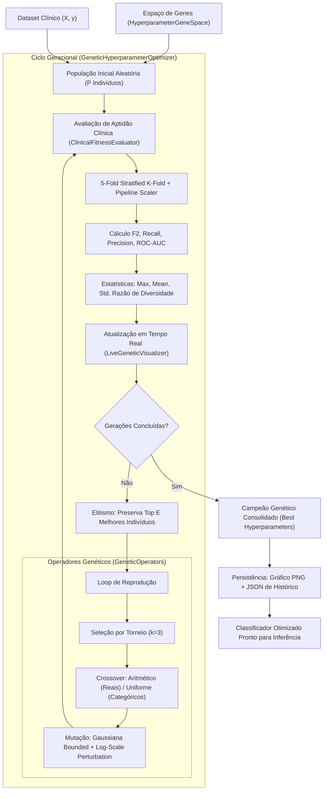

# Módulo de Otimização Genética de Hiperparâmetros (Projeto 1 - Fase 2) 🧬🔬🩺

Este módulo implementa um **Motor Evolutivo de Otimização de Hiperparâmetros** baseado em **Algoritmos Genéticos (AG)** voltado para a calibração de modelos preditivos clínicos (Câncer de Mama e Síndrome do Ovário Policístico - SOP).

O sistema substitui abordagens tradicionais de busca exaustiva (*Grid Search*) ou puramente aleatória (*Random Search*) por um processo guiado por **Aptidão Clínica**, priorizando a sensibilidade diagnóstica (**Recall / $F_2$-Score**) e a minimização severa de **Falsos Negativos**.

---

## 1. Fundamentos: Algoritmo Genético Aplicado a Hiperparâmetros

### 1.1. Por que Algoritmos Genéticos em Machine Learning?
O ajuste de hiperparâmetros (*hyperparameter tuning*) busca encontrar a combinação ideal de configurações de um algoritmo de aprendizado de máquina para maximizar sua capacidade de generalização sobre dados não vistos.

As abordagens tradicionais apresentam gargalos severos:
- **Grid Search:** Sofre com a **maldição da dimensionalidade** ($O(K^D)$). Se testarmos 5 valores para 6 parâmetros contínuos/inteiros, são necessárias $5^6 = 15.625$ iterações de treino e validação cruzada, tornando-se proibitivo em tempo e computação.
- **Random Search:** Testa combinações aleatórias sem memória de aprendizado. Não explora regiões promissoras identificadas em iterações anteriores.
- **Algoritmo Genético (Meta-heurística Populacional):** Equilibra **Exploração** (*exploration* - busca em regiões desconhecidas do espaço hiperdimensional) e **Aproveitamento** (*exploitation* - refinamento das melhores configurações encontradas). O algoritmo aprende a cada geração quais blocos de genes (hiperparâmetros) geram modelos médicos mais confiáveis.

### 1.2. Representação Cromossômica Híbrida
Diferente de problemas combinatórios puros (como o Caixeiro Viajante/VRP, que opera sobre permutações inteiras), o ajuste de hiperparâmetros exige um **genótipo heterogêneo**:
1. **Genes Inteiros Limitados:** Valores discretos com limites estritos (ex: `n_estimators` $\in [20, 250]$, `max_depth` $\in [2, 25]$, `k_neighbors` $\in [1, 30]$).
2. **Genes Inteiros Opcionais (*Nullable*):** Genes que podem assumir um inteiro ou `None` (ex: `max_depth=None` para árvores sem poda prévia).
3. **Genes Reais Contínuos:** Valores contínuos em escala linear (ex: taxa de aprendizado `learning_rate` $\in [0.01, 0.3]$).
4. **Genes Reais em Escala Logarítmica:** Parâmetros que variam em ordens de magnitude (ex: penalidade SVM $C \in [10^{-2}, 10^2]$, taxa de regularização MLP $\alpha \in [10^{-5}, 10^{-2}]$). A amostragem e a mutação operam no domínio dos expoentes $\log_{10}$ para garantir densidade homogênea em todas as ordens de grandeza.
5. **Genes Categóricos Nominais:** Opções estruturais do algoritmo (ex: critério de divisão `criterion` $\in \{\text{"gini"}, \text{"entropy"}, \text{"log\_loss"}\}$, funções de ativação, métricas de distância Minkowski/Manhattan).

### 1.3. Aptidão Clínica e Minimização de Falsos Negativos
Em diagnósticos médicos de alta gravidade (como neoplasias mamárias malignas):
- Um **Falso Positivo (FP)** causa estresse emocional temporário e demanda exames confirmatórios de biópsia.
- Um **Falso Negativo (FN)** deixa um câncer ou distúrbio endócrino grave não detectado, adiando tratamentos oncológicos e colocando a vida do paciente em risco imediato.

Por essa razão, a acurácia global é enganosa e perigosa em dados médicos. A função de aptidão (*fitness*) deste módulo adota estritamente o **$F_2$-Score**:

$$F_2 = (1 + 2^2) \cdot \frac{\text{Precision} \times \text{Recall}}{(2^2 \times \text{Precision}) + \text{Recall}} = 5 \cdot \frac{\text{Precision} \times \text{Recall}}{4 \times \text{Precision} + \text{Recall}}$$

O $F_2$-Score atribui **$4\times$ mais importância ao Recall (Sensibilidade)** do que à Precisão, forçando a seleção natural a eliminar indivíduos da população que deixem pacientes positivos passarem sem detecção.

---

## 2. Arquitetura e Fluxo do Módulo

O ciclo de vida evolutivo opera em memória com validação cruzada estratificada em cada indivíduo:



---

## 3. Estrutura dos Arquivos e Suas Responsabilidades

| Arquivo | Responsabilidade Primária |
| :--- | :--- |
| [`__init__.py`](file:///c:/Users/PC/Documents/GitHub/tech-challenge-health-ai/backend/app/genetic/hyperopt/__init__.py) | Exporta as classes públicas (`HyperparameterGeneSpace`, `Chromosome`, `GeneticOperators`, `ClinicalFitnessEvaluator`, `GeneticHyperparameterOptimizer`, `LiveGeneticVisualizer`). |
| [`chromosome.py`](file:///c:/Users/PC/Documents/GitHub/tech-challenge-health-ai/backend/app/genetic/hyperopt/chromosome.py) | Define os limites e tipos de genes dos classificadores e a estrutura de dados do cromossomo com conversão para o Scikit-Learn. |
| [`fitness.py`](file:///c:/Users/PC/Documents/GitHub/tech-challenge-health-ai/backend/app/genetic/hyperopt/fitness.py) | Avaliador de aptidão clínica que executa **5-Fold Stratified K-Fold** com padronização interna e calcula o $F_2$-Score e métricas médicas. |
| [`operators.py`](file:///c:/Users/PC/Documents/GitHub/tech-challenge-health-ai/backend/app/genetic/hyperopt/operators.py) | Implementa operadores genéticos adaptados a hiperparâmetros: Seleção por Torneio e Roleta, Crossover Aritmético/Uniforme e Mutação Gaussiana com limites. |
| [`optimizer.py`](file:///c:/Users/PC/Documents/GitHub/tech-challenge-health-ai/backend/app/genetic/hyperopt/optimizer.py) | Motor evolutivo geracional com elitismo, cálculo de métricas de diversidade da população, callbacks e parada. |
| [`visualizer.py`](file:///c:/Users/PC/Documents/GitHub/tech-challenge-health-ai/backend/app/genetic/hyperopt/visualizer.py) | Visualizador gráfico dinâmico em Matplotlib que renderiza curvas em tempo real de $F_2$, Recall e Diversidade Genética. |

---

## 4. Detalhamento dos Componentes, Classes e Métodos

### 4.1. `chromosome.py` (Definição dos Genes e Indivíduo)

#### Classe `HyperparameterGeneSpace`
Centraliza os limites matemáticos e tipos de hiperparâmetros suportados para cada um dos classificadores clínicos do sistema:

- **Random Forest (`random_forest`):**
  - `n_estimators`: inteiro $\in [20, 250]$
  - `max_depth`: inteiro ou `None` $\in [3, 25]$
  - `min_samples_split`: inteiro $\in [2, 15]$
  - `min_samples_leaf`: inteiro $\in [1, 8]$
  - `criterion`: categórico $\in \{\text{"gini"}, \text{"entropy"}, \text{"log\_loss"}\}$
- **Support Vector Machine (`svm`):**
  - `C`: real logarítmico $\in [0.01, 100.0]$
  - `gamma`: real logarítmico $\in [0.0001, 1.0]$
  - `kernel`: categórico $\in \{\text{"rbf"}, \text{"linear"}, \text{"poly"}, \text{"sigmoid"}\}$
- **Gradient Boosting (`gradient_boosting`):**
  - `n_estimators`: inteiro $\in [30, 200]$
  - `learning_rate`: real contínuo $\in [0.01, 0.3]$
  - `max_depth`: inteiro $\in [2, 10]$
  - `min_samples_split`: inteiro $\in [2, 10]$
- **Multi-Layer Perceptron (`mlp`):**
  - `hidden_layer_1`: inteiro $\in [16, 128]$ neurônios
  - `alpha`: real logarítmico $\in [10^{-5}, 10^{-2}]$ (regularização L2)
  - `learning_rate_init`: real logarítmico $\in [0.0005, 0.05]$
- **K-Nearest Neighbors (`knn`):**
  - `n_neighbors`: inteiro $\in [1, 30]$
  - `weights`: categórico $\in \{\text{"uniform"}, \text{"distance"}\}$
  - `metric`: categórico $\in \{\text{"euclidean"}, \text{"manhattan"}, \text{"minkowski"}\}$
- **Regressão Logística (`logistic_regression`):**
  - `C`: real logarítmico $\in [0.01, 100.0]$
  - `solver`: categórico $\in \{\text{"lbfgs"}, \text{"liblinear"}\}$
  - `max_iter`: inteiro $\in [100, 500]$

#### Classe `Chromosome`
- `__init__(genes, fitness=0.0)`: Instancia um indivíduo com seu mapa de genes, aptidão e dicionário de métricas clínicas (`accuracy`, `recall`, `precision`, `f1`, `f2_score`, `roc_auc`).
- `random(cls, space) -> Chromosome`:
  Instancia um indivíduo aleatório respeitando a distribuição de cada tipo de gene:
  - `int`: `random.randint(min, max)`
  - `int_or_none`: 20% de probabilidade de ser `None`; 80% de ser inteiro no intervalo.
  - `float`: Amostragem uniforme linear arredondada em 4 casas decimais.
  - `float_log`: Amostragem exponencial uniforme: $10^{\text{Uniform}(\log_{10}(\min), \log_{10}(\max))}$.
  - `cat`: Seleção equiprovável via `random.choice`.
- `to_sklearn_params(self, model_name: str) -> Dict[str, Any]`:
  Converte a representação interna de genes em parâmetros nominais consumíveis diretamente pelo Scikit-Learn (ex: transforma `hidden_layer_1 = 64` na tupla `hidden_layer_sizes = (64,)` para o MLP).
- `copy(self) -> Chromosome`:
  Gera uma cópia profunda (*deep copy*) do indivíduo e de suas métricas, garantindo isolamento contra efeitos colaterais de mutações em indivíduos de elite.

---

### 4.2. `fitness.py` (Avaliador Clínico de Aptidão)

#### Classe `ClinicalFitnessEvaluator`
- `__init__(X, y, model_name, n_splits=5)`:
  Armazena matriz de atributos e vetor de rótulos clínicos e instancia o `StratifiedKFold(n_splits=5, shuffle=True, random_state=42)`.
- `_instantiate_model(params)`:
  Constrói o estimador Scikit-Learn com semente fixa (`random_state=42`).
  > [!IMPORTANT]
  > Para modelos sensíveis à magnitude das variáveis numéricas (`svm`, `mlp`, `knn`, `logistic_regression`), a instanciação encapsula o estimador dentro de uma `sklearn.pipeline.Pipeline` com `StandardScaler()` na entrada. Isso garante que a normalização ocorra **exclusivamente dentro de cada fold de treino**, prevenindo estritamente o vazamento de dados (*data leakage*).
- `evaluate(chromosome: Chromosome) -> float`:
  1. Itera sobre os 5 folds de treino e validação gerados pelo `StratifiedKFold`.
  2. Ajusta o modelo sobre os dados de treino do fold (`clf.fit(X_train, y_train)`).
  3. Gera predições pontuais e probabilísticas sobre o fold de validação (`X_val`).
  4. Computa as métricas médicas fold a fold:
     - $F_2$-Score ($\beta = 2$, com proteção contra divisão por zero)
     - Recall (Sensibilidade diagnóstica)
     - Precision (Valor Preditivo Positivo)
     - Acurácia
     - $F_1$-Score
     - ROC-AUC (com fallback para 0.5 em estimadores que não suportam probabilidades)
  5. Se qualquer fold falhar por parametrização matematicamente incompatível, captura a exceção e penaliza o indivíduo atribuindo aptidão $0.0$.
  6. Calcula a média aritmética de cada métrica entre os 5 folds e atualiza os atributos `chromosome.fitness` e `chromosome.metrics`. Retorna o $F_2$-Score médio consolidado.

---

### 4.3. `operators.py` (Operadores Genéticos Híbridos)

#### Classe `GeneticOperators`
- `tournament_selection(population, k=3) -> Chromosome`:
  Realiza seleção por **Torneio Estocástico**: sorteia $k$ competidores aleatórios da população e elege o de maior aptidão ($F_2$). Garante pressão seletiva ajustável sem o risco de dominância prematura comum à roleta tradicional.
- `roulette_selection(population) -> Chromosome`:
  Seleção por **Roleta Proporcional ao Fitness**, deslocando os valores para escala estritamente não-negativa com offset infinitesimal ($10^{-4}$).
- `crossover(parent1, parent2, space, pc=0.85) -> Tuple[Chromosome, Chromosome]`:
  Aplica recombinação com probabilidade $p_c$:
  - **Crossover Aritmético (para Genes Reais e Log-Reais):**
    Gera uma combinação linear ponderada pelo fator estocástico $\alpha \sim \text{Uniform}(0, 1)$:
    $$c_1 = \alpha \cdot p_1 + (1 - \alpha) \cdot p_2$$
    $$c_2 = (1 - \alpha) \cdot p_1 + \alpha \cdot p_2$$
    O valor resultante é truncado (*clipped*) nos limites $[\min, \max]$ do gene.
  - **Crossover Uniforme (para Genes Inteiros e Categóricos):**
    Cada gene tem 50% de chance de ser herdado do pai 1 ou do pai 2, promovendo troca modular de estruturas.
- `mutate(chromosome, space, pm=0.15) -> Chromosome`:
  Percorre cada gene do indivíduo aplicando mutação com probabilidade $p_m$:
  - **Inteiros:** Adiciona perturbação gaussiana $\delta \sim \mathcal{N}(0, 0.1 \times (\max - \min))$ e arredonda para o inteiro mais próximo dentro dos limites.
  - **Inteiros Opcionais (*Nullable*):** 20% de chance de se tornar `None`; caso contrário, aplica perturbação gaussiana.
  - **Reais Lineares:** Adiciona ruído gaussiano $\delta \sim \mathcal{N}(0, 0.1 \times (\max - \min))$, mantendo os limites.
  - **Reais em Escala Logarítmica:** Aplica a perturbação no expoente da base 10:
    $$u = \log_{10}(\text{valor atual})$$
    $$u' = u + \mathcal{N}(0, 0.3)$$
    $$\text{novo valor} = 10^{u'}$$
    Garante que a mutação explore ordens de magnitude superiores e inferiores de forma equilibrada.
  - **Categóricos:** Seleciona aleatoriamente um valor distinto dentre as opções possíveis do espaço.

---

### 4.4. `optimizer.py` (Motor Evolutivo e Orquestração)

#### Classe `GeneticHyperparameterOptimizer`
- `__init__(...)`:
  Configura tamanho da população, número de gerações, taxas de mutação/crossover, contagem de elitismo, parâmetros de torneio, semente, caminhos para salvar gráficos e callback por geração (`on_generation`).
- `run() -> Dict[str, Any]`:
  Executa o ciclo geracional:
  1. **Geração 0 (Inicialização):** Cria $P$ indivíduos aleatórios no espaço `HyperparameterGeneSpace` e calcula o fitness inicial de cada um.
  2. **Monitoramento e Diversidade Genética:**
     A cada geração, computa a média, melhor fitness, desvio padrão e a **Taxa de Diversidade Genética** da população:
     $$\text{Diversity Ratio} = \frac{\text{Número de Genótipos Únicos}}{\text{Tamanho da População}}$$
     Essa métrica monitora ativamente o risco de estagnação genética e convergência prematura em mínimos locais.
  3. **Preservação de Elite (Elitismo):**
     Clona os $E$ melhores indivíduos (`elitism_count = 2`) diretamente para a próxima geração, garantindo monotonicidade do melhor resultado global.
  4. **Ciclo Reprodutivo:**
     Preenche o restante da população selecionando pais por torneio, aplicando crossover híbrido e mutações gaussianas limitadas.
  5. **Notificações:** Invoca o visualizador dinâmico (`LiveGeneticVisualizer`) e eventuais callbacks cadastrados.
  6. **Retorno:** Retorna o dicionário com os melhores hiperparâmetros, melhores métricas clínicas e o histórico geracional completo de convergência.

---

### 4.5. `visualizer.py` (Visualização Dinâmica da Convergência)

#### Classe `LiveGeneticVisualizer`
Implementa um painel de visualização em alta resolução composto por dois subplots verticais com atualização em tempo real (*dynamic live plotting*):

- **Subplot 1 (Convergência de Aptidão Clínica):**
  - Curva verde contínua com marcadores circulares: **Melhor $F_2$-Score** atingido até a geração atual.
  - Curva azul tracejada: **$F_2$-Score Médio** de toda a população.
  - Demonstra a taxa de aprendizado e aproximação assintótica do pico de aptidão.
- **Subplot 2 (Dinâmica da População):**
  - Curva vermelha com marcadores quadrados: **Recall do Campeão**, demonstrando a blindagem contra Falsos Negativos.
  - Curva roxa traço-ponto: **Diversidade Genética**, ilustrando como a população transita de alta exploração inicial para refinamento e consenso.
- Métodos auxiliares:
  - `update(history, current_gen)`: Redesenha os eixos e dispara `plt.pause(0.02)` se o modo GUI estiver disponível. Em servidores headless, opera de forma silenciosa e resiliente.
  - `save(output_path)`: Exporta a figura consolidada em 150 DPI para inclusão em relatórios e documentação.
  - `close()`: Finaliza a janela do Matplotlib e libera a memória gráfica.

---

## 5. Como Testar e Validar Este Módulo

### 5.1. Execução da Suíte de Testes Automatizados
O módulo conta com testes unitários abrangentes com o framework `pytest`:

```bash
# Executa todos os testes do otimizador genético de hiperparâmetros
pytest backend/tests/test_genetic_hyperopt.py -v
```

### 5.2. Casos de Teste Homologados (`test_genetic_hyperopt.py`):
1. `test_chromosome_bounds_and_sklearn_params`:
   Valida que a inicialização estocástica respeita integralmente os limites dos genes (`bounds`), as categorias autorizadas e que o método `to_sklearn_params()` devolve o dicionário no padrão oficial do Scikit-Learn.
2. `test_genetic_operators_mutation_and_crossover`:
   Valida a integridade do Crossover (geração de dois novos indivíduos válidos) e que a Mutação Gaussiana com taxa $1.0$ perturba os valores sem jamais violar os limites mínimos e máximos permitidos.
3. `test_clinical_fitness_evaluator_synthetic`:
   Valida o cálculo do $F_2$-Score e do Recall em 3 folds estratificados sobre dados sintéticos, assegurando que o fitness pertença ao intervalo $[0.0, 1.0]$.
4. `test_multimodel_spaces_and_evaluation`:
   Itera e testa a avaliação clínica em todos os classificadores suportados (`knn`, `logistic_regression`, `gradient_boosting`, `svm`, `mlp`), comprovando compatibilidade transversal da pipeline de escalonamento e instanciação.
5. `test_visualizer_creation_and_update`:
   Valida a inicialização do visualizador gráfico dinâmico em modo headless, a atualização a partir de um histórico de gerações e o salvamento em disco de arquivo PNG válido e não-corrompido (> 1KB).

---

## 6. Como Executar os Experimentos de Treinamento

O script `backend/training_scripts/train_genetic_hyperopt.py` oferece interface de linha de comando para conduzir tanto os benchmarks oficiais da Fase 2 quanto a calibração de modelos específicos:

```bash
# 1. Executa o Benchmark dos 3 Experimentos (Quick, Balanced e Robust) para Câncer de Mama:
python backend/training_scripts/train_genetic_hyperopt.py --dataset cancer

# 2. Otimiza um classificador específico com visualização gráfica em tempo real:
python backend/training_scripts/train_genetic_hyperopt.py --dataset cancer --model random_forest --live-plot

# 3. Otimiza Support Vector Machine para o dataset de SOP (PCOS):
python backend/training_scripts/train_genetic_hyperopt.py --dataset pcos --model svm
```

### Configurações Experimentais da Fase 2:
- **Experimento 1 (Convergência Rápida):** População 20, 10 Gerações, Mutação 0.05, Crossover 0.70, Elitismo 1.
- **Experimento 2 (Equilibrado - Padrão de Produção):** População 40, 20 Gerações, Mutação 0.15, Crossover 0.85, Elitismo 2.
- **Experimento 3 (Robusto / Busca Profunda):** População 60, 30 Gerações, Mutação 0.25, Crossover 0.90, Elitismo 3.

---

## 7. Integração com a Solução Clínica Global

Os pesos dos melhores modelos calibrados pelo algoritmo genético são serializados em `weights/models/best_model_<dataset>_<model>.joblib` e consumidos diretamente pelos endpoints da API FastAPI (`backend/app/api/routers/predictions_router.py`), disponibilizando predições diagnósticas com máxima sensibilidade clínica para o Painel Web Angular.
