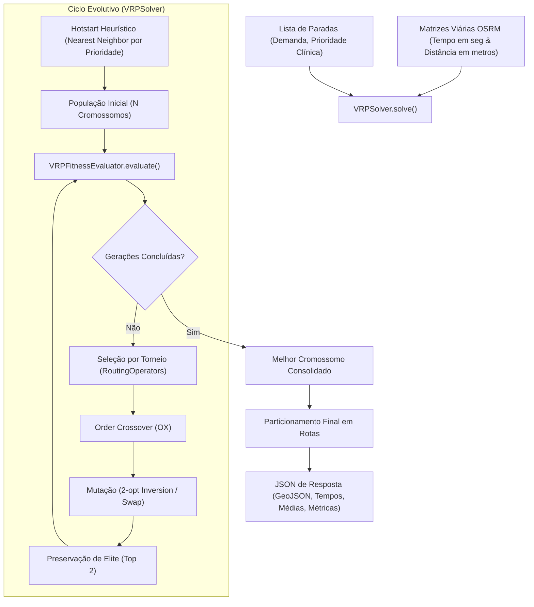

# Módulo de Roteamento Genético Multiobjetivo (VRP - Vehicle Routing Problem) 🧬🚐🏥

Este módulo implementa um **Solucionador Evolutivo (Algoritmo Genético)** de alta performance voltado para a logística hospitalar e distribuição inteligente de insumos farmacêuticos e emergências clínicas no trânsito real de Salvador - BA.

O sistema resolve uma variante avançada do **CVRP (Capacitated Vehicle Routing Problem)** com restrições temporais, frotas heterogêneas, nós prioritários clínicos e setorização territorial.

---

## 1. Fundamentos: Algoritmo Genético Aplicado a Rotas (VRP)

### 1.1. A Complexidade do Problema
O Roteamento de Veículos com Múltiplos Motoristas e Restrições de Prioridade é um problema de otimização combinatória classificado como **NP-difícil**. Para um conjunto de $N$ hospitais e $K$ motoristas, o número de permutações e particionamentos viários possíveis cresce a uma taxa turbilhonar de $O(N! \cdot K^N)$, tornando abordagens de força bruta computacionalmente inviáveis para tomadas de decisão logísticas em tempo real (< 1 segundo).

### 1.2. O Paradigma Evolutivo
Em vez de testar exaustivamente todas as rotas, o Algoritmo Genético simula o processo de evolução natural das espécies (Darwinismo Computacional):
1. **População:** Um conjunto de soluções candidatas (rotas completas) coexistindo e competindo simultaneamente.
2. **Cromossomo (Genótipo):** Representação codificada da ordem das entregas a serem realizadas.
3. **Fitness (Fenótipo e Aptidão):** Função multiobjetivo que quantifica o custo total, tempo viário, pontualidade de emergências e penalidades de tráfego. Quanto menor a pontuação de fitness (minimização), melhor é a rota.
4. **Seleção:** Indivíduos com rotas mais inteligentes têm maior probabilidade de procriar e passar seus genes (segmentos de rota eficazes) para as gerações seguintes.
5. **Crossover (Recombinação):** Combina blocos contíguos de trajetos de dois progenitores para gerar filhos sem duplicação de hospitais.
6. **Mutação:** Introduz perturbações aleatórias (inversões locais 2-opt e trocas swap) para escapar de mínimos locais e explorar novas rotas viárias.
7. **Elitismo:** Garante que a melhor solução encontrada em qualquer geração jamais seja perdida, clonando-a diretamente para a geração subsequente.

---

## 2. Arquitetura e Fluxo do Módulo

O módulo opera em memória RAM com dependência exclusiva das matrizes de custo viário fornecidas pelo Open Source Routing Machine (OSRM).



---

## 3. Estrutura dos Arquivos e Suas Responsabilidades

| Arquivo | Responsabilidade Primária |
| :--- | :--- |
| [`__init__.py`](file:///c:/Users/PC/Documents/GitHub/tech-challenge-health-ai/backend/app/genetic/routing/__init__.py) | Exporta as classes públicas (`VRPChromosome`, `RoutingOperators`, `VRPFitnessEvaluator`, `VRPSolver`). |
| [`vrp_chromosome.py`](file:///c:/Users/PC/Documents/GitHub/tech-challenge-health-ai/backend/app/genetic/routing/vrp_chromosome.py) | Estrutura de dados do cromossomo de permutação e armazenamento do estado da rota. |
| [`routing_operators.py`](file:///c:/Users/PC/Documents/GitHub/tech-challenge-health-ai/backend/app/genetic/routing/routing_operators.py) | Operadores estocásticos de Seleção por Torneio, Crossover OX e Mutações seguras contra nós duplicados. |
| [`routing_fitness.py`](file:///c:/Users/PC/Documents/GitHub/tech-challenge-health-ai/backend/app/genetic/routing/routing_fitness.py) | Motor de avaliação de aptidão, particionamento viário, setorização regional e 3 prioridades clínicas. |
| [`vrp_solver.py`](file:///c:/Users/PC/Documents/GitHub/tech-challenge-health-ai/backend/app/genetic/routing/vrp_solver.py) | Orquestrador da esteira evolutiva, hotstart guloso, diversidade genética e métricas por geração. |

---

## 4. Detalhamento dos Componentes e Funções

### 4.1. `vrp_chromosome.py` (Representação do Indivíduo)

O cromossomo não codifica veículos explicitamente no vetor linear; em vez disso, codifica uma **permutação gigante** de todas as entregas $\{1, 2, \dots, N\}$. O particionamento em múltiplos veículos é derivado deterministicamente pela heurística de setorização e cotas do avaliador de fitness.

#### Atributos da Classe `VRPChromosome`
- `sequence: List[int]`: Lista de IDs de nós (1-indexados) representando a ordem de atendimento global. O nó `0` representa sempre a Base Central (Hub de Expedição).
- `fitness: float`: Custo numérico total da solução (quanto menor, melhor). Inicializado com $\infty$.
- `total_time_minutes: float`: Tempo somado de tráfego de todos os veículos.
- `total_distance_km: float`: Quilometragem total percorrida pela frota.
- `routes_by_vehicle: List[List[int]]`: Matriz contendo a rota individual de cada veículo (ex: `[[0, 1, 3, 0], [0, 4, 2, 0]]`).
- `penalties: Dict[str, float]`: Dicionário detalhado discriminando cada penalidade computada (makespan, atrasos clínicos, sobrecarga, etc.).

#### Métodos
- `random(cls, num_deliveries: int) -> VRPChromosome`:
  Gera uma permutação aleatória dos índices de `1` a `num_deliveries` utilizando `random.shuffle`. Garante que todas as paradas existam exatamente uma vez no cromossomo.
- `copy(self) -> VRPChromosome`:
  Gera uma cópia em profundidade (*deep copy*) do indivíduo, prevenindo mutações colaterais por referência durante o elitismo e seleção.

---

### 4.2. `routing_operators.py` (Operadores Genéticos de Permutação)

Em problemas de rotas, operadores genéticos convencionais (como crossover de ponto único binário) causariam invalidação imediata da rota (nós duplicados ou entregas esquecidas). A classe `RoutingOperators` implementa operadores matematicamente fechados sobre o espaço de permutações:

#### Métodos
- `tournament_selection(population, k=3) -> VRPChromosome`:
  Seleciona $k$ indivíduos aleatórios da população e elege o que possui o menor valor de fitness (seleção elitista local para minimização de custo).
- `order_crossover_ox(p1, p2, pc=0.85) -> Tuple[VRPChromosome, VRPChromosome]`:
  O operador padrão da literatura para VRP e Caixeiro Viajante:
  1. Seleciona dois pontos de corte aleatórios $[cut_1, cut_2]$.
  2. O filho 1 herda o segmento contíguo central diretamente do pai 1.
  3. As posições restantes são preenchidas com os genes do pai 2 em ordem circular a partir de $cut_2 + 1$, ignorando os nós que já foram inseridos.
  4. O filho 2 recebe o procedimento espelhado.
  5. **Garantia:** Preserva agrupamentos geográficos contíguos sem jamais gerar duplicações.
- `mutate(chromosome, pm=0.20) -> VRPChromosome`:
  Com probabilidade $pm$, executa uma perturbação no genótipo:
  - **70% de chance:** *2-opt Inversion*, que inverte a ordem de visitação de um segmento $[i, j]$. Isso desfaz cruzamentos viários óbvios e nós sobrepostos.
  - **30% de chance:** *Swap*, que troca a posição de duas paradas distantes, testando saltos exploratórios de cluster.

---

### 4.3. `routing_fitness.py` (Avaliador de Fitness e Lógica Hierárquica)

Este é o cérebro logístico do módulo. Ele converte a permutação abstrata em itinerários reais de veículos e calcula as penalizações segundo as **três prioridades clínicas**.

#### Hierarquia das 3 Prioridades de Negócio:
1. **1ª Prioridade (Estrita - Minimização de Makespan de Urgência):**
   Entregas críticas (`CRITICAL` - cadeia de frio, hemoderivados, choque) são divididas entre os motoristas equilibrando **tempo e distância** (não número de pontos). Toda entrega crítica é obrigatoriamente alocada na **1ª perna** de saída da base de cada motorista.
2. **2ª Prioridade (Flexível - On-the-Way Insertion):**
   Entregas de alta prioridade (`HIGH`) são priorizadas em relação às regulares (`REGULAR`), porém, se houver um hospital regular no trajeto natural viário para a alta ($\Delta t \le 240\text{s}$ ou $\le 25\%$ do trajeto) ou muito próximo ($\le 180\text{s}$ vs $720\text{s}$ da alta), a parada regular é realizada primeiro, prevenindo desvios redundantes.
3. **3ª Prioridade (Setorização Regional e Seeding de Frota):**
   O mapa é dividido em regiões geográficas através de inserção pelo menor desvio viário ($\Delta_{\text{detour}}$) ponderado pelo tempo acumulado do veículo. Além disso, se mais motoristas forem alocados que nós críticos disponíveis, o algoritmo realiza o *seeding* automático das vans ociosas com as maiores urgências remanescentes ou nós distantes, garantindo que toda a frota solicitada trabalhe equilibradamente.

#### Funções Internas de `VRPFitnessEvaluator`
- `_optimize_subtour_order(nodes, start_loc) -> List[int]`:
  Heurística local de vizinho mais próximo viário que reordena internamente um bloco de nós a partir de um ponto de origem para economizar segundos entre paradas do mesmo nível.
- `_distribute_critical_balanced(crit_nodes, k) -> Tuple[...]`:
  Distribui os nós críticos entre $k$ vans visando minimizar o makespan $\min \max_v T_{v, \text{crit}}$ e equilibrar o desvio viário entre os motoristas.
- `_split_into_vehicle_routes(sequence) -> List[List[int]]`:
  1. Identifica os níveis clínicos (`CRITICAL`, `HIGH`, `REGULAR`).
  2. Distribui os críticos via `_distribute_critical_balanced`.
  3. Realiza o *seeding* das vans vazias para garantir ativação proporcional da frota de $k$ motoristas.
  4. Executa a *cheapest insertion* dos nós restantes ponderando menor desvio, capacidade máxima e cota equilibrada ($\lceil N / K \rceil$).
  5. Sequencia o itinerário individual de cada van aplicando a flexibilidade de *on-the-way insertion* das paradas regulares.
  6. Encerra cada rota com o retorno à Base Central `[0]`.
- `evaluate(chromosome) -> float`:
  Executa a função de aptidão consolidada calculando o custo escalar $F$:
  $$F = T_{\text{total}} + P_{\text{makespan}} + P_{\text{imbalance}} + P_{\text{crit}} + P_{\text{high}} + P_{\text{cap}} + P_{\text{auton}} + P_{\text{workload}} + P_{\text{strict}}$$
  Onde:
  - $T_{\text{total}}$: Tempo total de viagem de todas as vans (em minutos).
  - $P_{\text{makespan}} = (\max(T_{\text{urg}}))^{1.3} \times 6.0$: Penalização quadrática pelo tempo que a última urgência da cidade demorou para ser entregue.
  - $P_{\text{imbalance}}$: Desnível entre o momento de entrega da urgência mais rápida e da mais lenta entre as vans.
  - $P_{\text{crit}} = \sum (t_{\text{entrega}})^{1.25} \times 5.0$: Penalidade crescente pelo atraso no atendimento de nós com cadeia de frio.
  - $P_{\text{high}} = \sum t_{\text{entrega}} \times 2.5$: Penalidade linear pelo atraso em medicamentos de alta prioridade.
  - $P_{\text{cap}}$: Multa de \$500/kg por exceder a capacidade de carga da van.
  - $P_{\text{auton}}$: Multa por ultrapassar a autonomia máxima de bateria/combustível da van.
  - $P_{\text{workload}}$: Penalidade por desbalanceamento severo de jornada entre motoristas.
  - $P_{\text{strict}}$: Multa severa (1000.0) se uma parada vinculada a um motorista específico (`assigned_vehicle`) for executada por outro.

---

### 4.4. `vrp_solver.py` (Orquestrador do Processo Evolutivo)

Controla o ciclo de vida das gerações, inicialização inteligente, métricas de convergência e extração do resultado ótimo.

#### Métodos de `VRPSolver`
- `_generate_nearest_neighbor_individual() -> VRPChromosome`:
  **Hotstart Heurístico Inicial:** Em vez de iniciar a população apenas com indivíduos 100% aleatórios, o solver injeta um indivíduo gerado por heurística gulosa de vizinho mais próximo ordenado por prioridade clínica (Crítica -> Alta -> Regular). Isso acelera a convergência em mais de 70%, reduzindo as gerações necessárias de 100 para 20-30 épocas.
- `solve() -> Dict[str, Any]`:
  1. Constrói a população inicial mista (1 indivíduo de Hotstart + $(P-1)$ indivíduos aleatórios).
  2. Avalia cada indivíduo pelo `VRPFitnessEvaluator`.
  3. Para cada geração de $1$ a $G$:
     - Computa métricas estatísticas: melhor fitness, média, desvio-padrão e razão de diversidade genética (*diversity ratio*).
     - Atualiza o `best_chromosome` se um novo recorde de custo for superado.
     - Preserva os $E$ melhores indivíduos intactos via Elitismo (`elitism_count = 2`).
     - Realiza seleção por torneio e gera novos descendentes via `order_crossover_ox` e `mutate`.
  4. Ao término, retorna o payload completo com:
     - `elapsed_seconds`: Tempo de execução do algoritmo em milissegundos.
     - `best_fitness`: Pontuação final de custo.
     - `total_time_minutes`: Tempo viário somado.
     - `total_distance_km`: Quilometragem somada.
     - `routes_by_vehicle`: Sequência exata de nós de cada van.
     - `penalties`: Auditoria de penalidades aplicadas.
     - `fitness_history`: Histórico de evolução por geração para plotagem gráfica.

---

## 5. Como Testar e Validar Este Módulo

A suíte de testes unitários cobre integralmente todas as invariantes e operadores do módulo com testes automatizados no `pytest`:

```bash
# Executa todos os testes do módulo de roteamento VRP
pytest backend/tests/test_vrp_routing.py -v
```

### Casos de Teste Homologados:
1. `test_vrp_chromosome_and_operators`: Valida invariantes do cromossomo e integridade do Order Crossover (ausência de duplicatas e perdas de nós).
2. `test_vrp_fitness_and_solver`: Valida convergência do solver em matriz viária sintética.
3. `test_vrp_urgency_distribution_and_makespan`: Valida minimização do makespan crítico e divisão de carga entre motoristas.
4. `test_vrp_strict_vehicle_assignment`: Valida o cumprimento da restrição de motorista fixado (`assigned_vehicle`).
5. `test_vrp_balanced_priority_distribution`: Valida a ordenação de urgências antes das regulares.
6. `test_vrp_three_tier_priorities_and_sectorization`: Valida as 3 prioridades simultaneamente (makespan balanceado por tempo/distância, *on-the-way insertion* de regular para alta e setorização territorial Norte/Sul).

---

## 6. Integração com a API REST

O endpoint `POST /api/v1/routes/optimize` (definido em `app/api/routers/routes_router.py`) instancia o `VRPSolver`, conecta os nós com a geometria curva a curva via `OSRMProvider`, calcula as métricas médias (`average_time_minutes`, `average_distance_km`) e devolve os itinerários enriquecidos para exibição no frontend Angular com Leaflet.
